<p align="center"></p>


<h1 align="center" id="gdd-game-design-document-módulo-1-inteli">GDD - Game Design Document - Módulo 1 - Inteli</h1>

# Bardot Studios

Ana Célia Augusta Santos do Amaral  
Anita Fratelli Sonobe Silveira  
Davi Viana Tricarico  
Gustavo Luz Fantasia Barbosa  
Isaac Nicolas Alves Silva  
João Pedro Fuzzo Poveda  
Pedro Lemos Negri
Valter Lucas Garcia de Lima

# Sumário

[1. Introdução](#1-introdução)  
<small>
[1.1 Plano Estratégico do Projeto](#11-plano-estratégico-do-projeto)  
[1.1.1 Contexto da Indústria](#111-contexto-da-indústria)  
[1.1.1.1 Modelo de 5 Forças de Porter](#1111-modelo-de-5-forças-de-porter)  
[1.1.1.2 Ameaça de Novos Entrantes](#1112-ameaça-de-novos-entrantes)  
[1.1.1.3 Ameaça de Produtos ou Serviços Substitutos](#1113-ameaça-de-produtos-ou-serviços-substitutos)  
[1.1.1.4 Poder de Barganha dos Fornecedores](#1114-poder-de-barganha-dos-fornecedores)  
[1.1.1.5 Poder de Barganha dos Clientes](#1115-poder-de-barganha-dos-clientes)  
[1.1.1.6 Rivalidade entre os Concorrentes Existentes](#1116-rivalidade-entre-os-concorrentes-existentes)  
[1.1.2 Análise Swot](#112-análise-swot)  
[1.1.3 Missão / Visão / Valores](#113-missão--visão--valores)  
[1.1.4 Proposta de Valor](#114-proposta-de-valor)  
[1.1.5 Descrição da Solução Desenvolvida](#115-descrição-da-solução-desenvolvida)  
[1.1.6 Matriz de Riscos](#116-matriz-de-riscos)  
[1.1.7 Objetivos, Metas e Indicadores](#117-objetivos-metas-e-indicadores)  
[1.2 Requisitos do Jogo](#12-requisitos-do-jogo)  
[1.3 Público-alvo do Projeto](#13-público-alvo-do-projeto)  
</small>

[2. Visão Geral do Jogo](#2-visão-geral-do-jogo)  
<small>
[2.1 Objetivos do Jogo](#21-objetivos-do-jogo)  
[2.2 Características do Jogo](#22-características-do-jogo)  
[2.2.1 Gênero do Jogo](#221-gênero-do-jogo)  
[2.2.2 Plataforma do Jogo](#222-plataforma-do-jogo)  
[2.2.3 Número de Jogadores](#223-número-de-jogadores)  
[2.2.4 Títulos semelhantes e Inspirações](#224-títulos-semelhantes-e-inspirações)  
[2.2.4.1 Meu Talking Tom - Android ou IOS](#2241-meu-talking-tom---android-ou-ios)  
[2.2.4.2 Nintendogs - Nintendo DS/3DS](#2242-nintendogs---nintendo-ds3ds)  
[2.2.4.3 Animal Shelter Simulator - Google Play e IOS](#2243-animal-shelter-simulator---google-play-e-ios)  
[2.2.5 Tempo estimado de jogo](#225-tempo-estimado-de-jogo)  
</small>

[3. Game Design](#3-game-design)  
<small>
[3.1 Enredo do Jogo](#31-enredo-do-jogo)  
[3.2 Personagens](#32-personagens)  
[3.2.1 Controláveis](#321-controláveis)  
[3.2.2 Non-Playable Characters (NPC)](#322-non-playable-characters-npc)  
[3.2.3 Diversidade e Representatividade dos Personagens](#323-diversidade-e-representatividade-dos-personagens)  
[3.3 Mundo do Jogo](#33-mundo-do-jogo)  
[3.3.1 Locações Principais e/ou Mapas](#331-locações-principais-eou-mapas)  
[3.3.2 Navegação pelo mundo](#332-navegação-pelo-mundo)  
[3.3.3 Condições climáticas e temporais](#333-condições-climáticas-e-temporais)  
[3.3.4 Concept Art](#334-concept-art)  
[3.3.5 Trilha sonora](#335-trilha-sonora)  
[3.4 Inventário e Bestiário](#34-inventário-e-bestiário)  
[3.5 Gameflow](#35-gameflow)  
[3.6 Regras do Jogo](#36-regras-do-jogo)  
[3.7 Mecânicas do Jogo](#37-mecânicas-do-jogo)  
[3.7.1 Descrição Geral das Mecânicas](#371-descrição-geral-das-mecânicas)  
[3.7.2 Mecânicas do Minigame de Banho](#372-mecânicas-do-minigame-de-banho)  
[3.7.3 Mecânicas do Minigame de Alimentação](#373-mecânicas-do-minigame-de-alimentação)  
[3.7.4 Mecânicas do Minigame Veterinário](#374-mecânicas-do-minigame-veterinário)  
[3.7.5 Mecânicas do Minigame de Lazer](#375-mecânicas-do-minigame-de-lazer)  
[3.7.6 Progressão do Jogo](#376-progressão-do-jogo)  
[3.8 Implementação Matemática de Animação/Movimento](#38-implementação-matemática-de-animaçãomovimento)  
</small>

[4. Desenvolvimento do jogo](#4-desenvolvimento-do-jogo)  
<small>
[4.1 Desenvolvimento preliminar do Jogo](#41-desenvolvimento-preliminar-do-jogo)  
[4.2 Desenvolvimento básico do Jogo](#42-desenvolvimento-básico-do-jogo)  
[4.3 Desenvolvimento intermediário do Jogo](#43-desenvolvimento-intermediário-do-jogo)  
[4.4 Desenvolvimento final do MVP](#44-desenvolvimento-final-do-mvp)  
[4.5 Revisão do MVP](#45-revisão-do-mvp)  
</small>

[5. Casos de Teste](#5-casos-de-teste)  
<small>
[5.1 Casos de Teste](#51-casos-de-teste)
[5.2.1 Registros de testes](#521-registros-de-testes)  
[5.2.2 Melhorias](#522-melhorias)  
</small>

[6. Conclusões e trabalhos futuros](#6-conclusões-e-trabalhos-futuros)  

[7. Referências](#7-referências)  

[Anexos](#anexos)

<br>

# 1. Introdução

## 1.1. Plano Estratégico do Projeto

### 1.1.1. Contexto da indústria 

&ensp; O varejo pet brasileiro é um setor em expansão, marcado pela transição de um mercado fragmentado, dominado por pequenos pet shops de bairro, para grandes redes especializadas e marketplaces. Impulsionado pela "humanização" dos animais e pela multicanalidade, o segmento movimenta bilhões anualmente. O cenário é ditado pela consolidação de grandes players, como a fusão entre Cobasi e Petz, que buscam escala e eficiência logística para ampliar a oferta de produtos e serviços em ambiente cada vez mais competitivo e digital (CONSELHO ADMINISTRATIVO DE DEFESA ECONÔMICA – CADE, 2025; INVESTING.COM, 2024). 
Além disso, dados financeiros reforçam a estratégia de integração operacional e ganhos de sinergia entre as companhias, evidenciando a consolidação do setor (PETZCOBASI RI, 2026).

#### 1.1.1.1. Modelo de 5 Forças de Porter 

&ensp; As Cinco Forças de Porter são uma ferramenta usada para entender como funciona a competição dentro de um mercado. Dessa forma, ela analisa quem pode entrar no setor como novo concorrente, quais empresas já disputam clientes, se existem alternativas que podem substituir o serviço oferecido, e qual é o poder de negociação de fornecedores e consumidores.
Neste projeto, utilizamos esse modelo para compreender melhor o mercado pet onde a marca está inserida. Isso ajuda a entender os desafios, oportunidades e o nível de concorrência do setor, permitindo que as decisões estratégicas do jogo estejam alinhadas à realidade do mercado em que a empresa atua.

##### 1.1.1.2 Ameaça de Novos Entrantes

&ensp;A Ameaça de Novos Entrantes analisa o nível de dificuldade para novas empresas ingressarem no setor e competirem com os players já estabelecidos.
O mercado pet brasileiro movimentou cerca de R$77,2 bilhões em 2025, com projeção de R$80 bilhões em 2026 (ABRAS, 2025), sendo um setor atrativo e em expansão. Embora a abertura de pequenos pet shops seja acessível, competir em escala nacional exige alto investimento em infraestrutura, logística, marketing e construção de marca (NEOFEED, 2024; CONSUMIDOR MODERNO, 2024). Grandes grupos como Petz e Cobasi possuem forte poder de negociação, capilaridade e estratégia omnichannel, dificultando a entrada de novos concorrentes relevantes (CADE, 2024).
Assim, a ameaça é considerada baixa a moderada, restrita principalmente a nichos específicos ou modelos digitais inovadores.


##### 1.1.1.3 Ameaça de Produtos ou Serviços Substitutos

&ensp;A Ameaça de Produtos ou Serviços Substitutos analisa a possibilidade de os consumidores atenderem à mesma necessidade por meio de alternativas diferentes das oferecidas pelas empresas do setor, podendo reduzir sua demanda ou pressionar preços, conforme o modelo das Cinco Forças (PORTER, 2008).
No varejo pet, os principais substitutos estão relacionados a canais alternativos de compra, como supermercados, marketplaces generalistas, como Amazon, Shopee e Mercado Livre, e compras diretas de fabricantes, ampliadas pelo avanço do comércio eletrônico no Brasil (E-COMMERCE BRASIL, 2023). Esses canais oferecem produtos básicos, especialmente ração e acessórios, muitas vezes com preços mais competitivos e maior transparência de comparação (SBVC, 2024). Além disso, pequenas lojas de bairro também competem por conveniência local, oferecendo entregas rápidas em regiões específicas.  Entretanto, a Cobasi reduz essa ameaça ao investir em diferenciação por meio de ampla variedade de produtos, serviços especializados, como banho e tosa, e logística de entrega rápida, que exige infraestrutura, tecnologia e capilaridade nacional, especialmente após o movimento de consolidação com a Petz (CONSELHO ADMINISTRATIVO DE DEFESA ECONÔMICA – CADE, 2025). Dessa forma, embora existam alternativas disponíveis ao consumidor, a ameaça de substitutos é considerada moderada, sendo mais relevante no segmento de produtos padronizados e sensível a preço.


##### 1.1.1.4 Poder de Barganha dos Fornecedores

&ensp;O Poder de Barganha dos Fornecedores, dentro do modelo das Cinco Forças de Porter, analisa o nível de influência que os fornecedores exercem sobre as empresas do setor, especialmente na definição de preços, condições comerciais e disponibilidade de produtos. Quanto maior a dependência das empresas em relação a poucos fornecedores estratégicos, maior tende a ser esse poder.
No varejo pet brasileiro, os principais fornecedores são grandes indústrias de ração e produtos especializados, como BRF Pet, Special Dog e Premier Pet, que figuram entre as maiores do segmento nacional (Panorama PET VET, 2024). Com a unificação entre Petz e Cobasi, houve aumento da concentração de demanda em um único grande grupo varejista, ampliando seu poder de negociação sobre fabricantes, inclusive para exigência de exclusividades e melhores condições comerciais.
Dessa forma, embora os fornecedores sejam relevantes e detenham marcas consolidadas, seu poder de barganha é considerado baixo a moderado, uma vez que grande parte das compras está concentrada em poucos varejistas de grande porte.


##### 1.1.1.5 Poder de Barganha dos Clientes

&ensp;O Poder de Barganha dos Clientes, segundo o modelo das Cinco Forças de Porter, analisa o nível de influência que os consumidores possuem sobre as empresas do setor, especialmente em relação a preços, qualidade, variedade e condições de compra. Quanto maior a oferta de alternativas disponíveis no mercado, maior tende a ser o poder de negociação dos clientes.
No mercado pet brasileiro, observa-se ampla presença de micro e pequenas empresas, que representam cerca de 98% do setor, sendo os microempreendedores individuais responsáveis por grande parcela da movimentação econômica. Pequenos e médios pet shops concentram aproximadamente 49% da receita do setor, enquanto grandes redes representam cerca de 9%. Clínicas e hospitais veterinários detêm 18% (Receita Federal, 2023). Esse cenário evidencia a elevada oferta de estabelecimentos e amplia as opções disponíveis aos consumidores finais, aumentando seu poder de escolha e sensibilidade a preço e qualidade.
Por outro lado, a recente fusão entre Cobasi e Petz, que juntas somam mais de 500 lojas no país, representa uma estratégia para ampliar escala, fortalecer a marca e reduzir a influência do cliente por meio de diferenciação, conveniência e integração omnichannel. Ainda assim, diante da concorrência de lojas virtuais como Shopee e Amazon, o poder de barganha dos clientes pode ser considerado moderado, pois há diversas alternativas disponíveis no mercado.


##### 1.1.1.6 Rivalidade entre os Concorrentes Existentes

&ensp; A Rivalidade entre os Concorrentes Existentes, no modelo das Cinco Forças de Porter, analisa o nível de competição direta entre as empresas que já atuam no setor. Essa força considera fatores como número de concorrentes, diferenciação de serviços, disputa por preço e intensidade das estratégias de mercado (PORTER, 2008).
No varejo pet brasileiro, a rivalidade é considerada elevada, especialmente após o processo de consolidação entre grandes redes especializadas (CONSELHO ADMINISTRATIVO DE DEFESA ECONÔMICA – CADE, 2025). Entre os concorrentes especializados, destaca-se a Petlove, com forte atuação em e-commerce, oferta de serviços veterinários e presença física, competindo diretamente na venda de produtos e serviços (PETLOVE, 2026).
Os marketplaces digitais, como Mercado Livre, Amazon, Shopee e TikTok Shop, exercem intensa concorrência no ambiente online, principalmente por meio de preços mais baixos, ampla variedade e alcance nacional, refletindo o crescimento do comércio eletrônico no Brasil (E-COMMERCE BRASIL, 2023). Já os supermercados, como Carrefour, Extra e Sonda, apresentam concorrência moderada, oferecendo produtos básicos e captando consumidores que realizam compras de rotina, embora não disponibilizem serviços especializados (SBVC, 2024).
Por fim, os pet shops de bairro competem fortemente no mercado local, com foco em relacionamento, flexibilidade de preços e oferta de serviços como banho e tosa. Apesar de não possuírem a escala das grandes redes, mantêm relevância regional. A rivalidade no setor é alta, especialmente no e-commerce e na venda de produtos padronizados, exigindo diferenciação estratégica por parte das grandes redes.


### 1.1.2. Análise SWOT 

&ensp; A análise SWOT (também denominada matriz FOFA) é um instrumento estratégico que permite avaliar a posição competitiva de uma organização a partir da interação entre fatores internos e externos. O modelo se estrutura em quatro dimensões: forças (strengths), que evidenciam vantagens internas; fraquezas (weaknesses), que apontam limitações internas; oportunidades (opportunities), relacionadas a condições externas favoráveis; e ameaças (threats), que representam riscos do ambiente externo (Casarotto, 2019). Ao organizar essas variáveis, a ferramenta apoia decisões mais consistentes e o direcionamento estratégico. Nesse contexto, apresenta-se a análise SWOT da Cobasi (Figura 1).

<div align="center">
  <p>Figura 1: Análise Swot</p>
  
  <p>Feito pela própria equipe (2026)</p>
</div>

<h2 align="center" id="strengths">Strengths</h2>

&ensp;As forças (strengths) correspondem aos atributos internos que sustentam a vantagem competitiva da organização (Casarotto, 2019). No caso da Cobasi, é possível destacar sua autoridade e credibilidade de marca como pioneira no setor pet, fator que fortalece a confiança do consumidor e a diferencia no mercado. Além disso, a empresa conta com um ecossistema omnichannel consolidado, com forte integração entre os canais físico e digital, proporcionando uma experiência de compra mais fluida.     Outro ponto relevante é a diversificação do portfólio, que abrange categorias complementares como jardinagem, aquarismo e casa, ampliando as oportunidades de venda. Por fim, o elevado poder de escala após a fusão fortalece sua capacidade de negociação com grandes fornecedores, gerando vantagens competitivas importantes.


<h2 align="center" id="weaknesses">Weaknesses</h2>

&ensp;As fraquezas (weaknesses) referem-se a limitações internas que podem restringir o desempenho ou a eficiência da organização (Casarotto, 2019). No caso da Cobasi, observa-se uma estrutura de custo fixo elevada, decorrente principalmente do modelo de megalojas, o que pode impactar a rentabilidade em cenários adversos. Além disso, a recente fusão com a Petz traz desafios relacionados à integração operacional e cultural, exigindo alinhamento entre processos, equipes e estratégias. Outro ponto de atenção é a concentração geográfica no mercado brasileiro, o que aumenta a exposição da empresa às variações econômicas locais e limita sua diversificação internacional.


<h2 align="center" id="opportunities">Opportunities</h2>

&ensp;As oportunidades (opportunities) dizem respeito a fatores externos positivos que podem ser explorados para promover crescimento e diferenciação (Casarotto, 2019). Para a Cobasi, destaca-se a possibilidade de verticalização do ecossistema de saúde pet, com expansão em serviços como hospitais e planos veterinários, agregando valor ao cliente. Também há espaço para acelerar o desenvolvimento de marcas próprias, o que permite maior controle sobre margens e posicionamento de produtos. Além disso, a tendência de aumento do número de pets por família impulsiona estruturalmente a demanda do setor, criando um cenário favorável para expansão dos negócios.


<h2 align="center" id="threats">Threats</h2>

&ensp;As ameaças (threats) envolvem elementos externos que podem impactar negativamente o desempenho da organização (Casarotto, 2019). Entre as principais ameaças para a Cobasi está a guerra de preços em marketplaces, com forte pressão competitiva de grandes plataformas como Amazon e Mercado Livre. Outro fator relevante é a resiliência dos pet shops de bairro, que competem principalmente por meio da proximidade e do atendimento personalizado. Soma-se a isso a possibilidade de restrições regulatórias associadas às exigências do CADE após a fusão, que podem limitar estratégias de crescimento. Por fim, a volatilidade no custo de commodities utilizadas na produção de rações também representa um risco, podendo impactar preços e margens.


### 1.1.3. Missão / Visão / Valores 

&ensp;De modo geral, missão expressa o propósito central de uma organização, ou seja, por que ela existe. A visão representa onde a empresa pretende chegar no futuro, enquanto os valores correspondem aos princípios que orientam suas decisões e comportamentos (TOTVS, 2024). A seguir, apresentam-se esses elementos aplicados à Cobasi.

###  Missão

&ensp;Proporcionar aos apaixonados por animais uma experiência de compra diferenciada, reunindo produtos de qualidade, atendimento especializado e preços competitivos em um ambiente confortável.

###  Visão

&ensp;Apesar de não divulgar formalmente uma declaração de visão, a atuação da empresa indica a intenção de se consolidar como referência no varejo pet, fortalecendo continuamente a experiência do cliente e a confiança na marca.

###  Valores

&ensp;O compromisso com o cliente é um dos pilares centrais, refletido na prioridade em oferecer um atendimento de qualidade e garantir a satisfação do consumidor em todas as interações. A ética também se destaca como um valor fundamental, orientando a conduta profissional com base na integridade e no respeito em todas as relações. Além disso, a transparência está presente na forma como a empresa se relaciona com clientes, parceiros e colaboradores, prezando sempre por comunicações claras e responsáveis.

&ensp;Outro aspecto importante é a busca constante pela excelência, que se traduz no alto padrão de qualidade dos produtos, serviços e no atendimento oferecido. A responsabilidade também faz parte da essência da organização, guiando suas ações de maneira consciente em relação ao negócio, à sociedade e ao bem-estar animal. Por fim, o trabalho em equipe é valorizado como um diferencial, incentivando a colaboração entre os colaboradores para alcançar melhores resultados e fortalecer o desempenho coletivo.

---

&ensp;A cultura organizacional da Cobasi evidencia forte orientação para a experiência do consumidor aliada a princípios éticos consistentes. Esses pilares sustentam a credibilidade da marca e direcionam a equipe na entrega de um atendimento de qualidade, favorecendo a fidelização do público pet.

### 1.1.4. Proposta de Valor 

&ensp;O Canvas de Proposta de Valor, desenvolvido por Alexander Osterwalder, Yves Pigneur e Alan Smith, é uma ferramenta estratégica que permite analisar de que maneira um produto ou serviço atende às necessidades reais de um público específico. O modelo busca assegurar que a solução proposta não apenas ofereça funcionalidades, mas também gere valor concreto ao usuário, ao aliviar dificuldades existentes e proporcionar benefícios relevantes.

&ensp;O Canvas é dividido em dois blocos complementares: o Perfil do Cliente, que descreve suas tarefas, dores e ganhos, e o Mapa de Valor, que apresenta os elementos da solução responsáveis por atender a essas necessidades. Essa estrutura permite avaliar a coerência entre o problema identificado e a proposta apresentada.

&ensp;No contexto do Cobasi Shelter, a solução foi elaborada considerando não apenas as necessidades do público-alvo, mas também o ambiente competitivo do mercado pet brasileiro, que movimenta cerca de R$80 bilhões em 2026 (Abinpet & Instituto Pet Brasil, 2026). O projeto leva em conta a fusão Cobasi-Petz e a presença de concorrentes digitais relevantes, como Petlove, Amazon e marketplaces especializados. Os pet shops tradicionais também continuam desempenhando papel importante na proximidade local com os clientes. Dessa forma, o Canvas de Proposta de Valor foi desenvolvido alinhando essas demandas do mercado aos objetivos institucionais da Cobasi, especialmente no que se refere à conscientização sobre bem-estar animal, educação de tutores e incentivo à adoção responsável. Para melhor visualização desses elementos, a Figura 2 ilustra a organização do Canvas de Proposta de Valor.


<br>
<div align="center">
  <p>Figura 2: Canva proposta de valor.</p>
  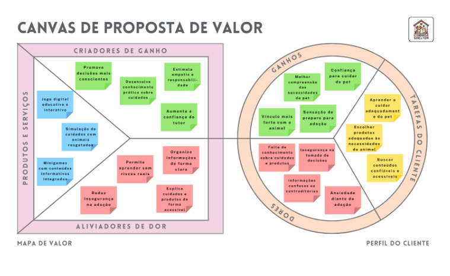
  <p>Feito pela própria equipe (2026) com base no modelo de negócios elaborado por Alexander Osterwalder, Yves Pigneur e Alan Smith.</p>
</div>
<br>

<h2 align="center" id="perfil-do-cliente">Perfil do Cliente</h2>
### Tarefas do Cliente (Customer Jobs)
&ensp; As tarefas do cliente representam as atividades, objetivos ou problemas que o público busca resolver em seu cotidiano. Elas correspondem ao que o usuário tenta realizar funcionalmente, emocionalmente ou socialmente ao interagir com um produto, serviço ou situação específica. Nesse contexto, estão relacionadas ao cuidado com animais e ao consumo de conteúdos digitais sobre o tema. Identificá-las permite compreender quais demandas orientam o comportamento do usuário e quais aspectos devem ser considerados no desenvolvimento da solução.
Principais tarefas identificadas: 
* Selecionar produtos adequados às necessidades do animal: Interesse em adquirir conhecimentos básicos e práticos para garantir uma rotina adequada e apropriada de cuidados com o pet.
* Avaliar a própria capacidade de cuidar de um animal antes da adoção: Busca por compreender as responsabilidades envolvidas antes de assumir o compromisso.
* Consumir conteúdos confiáveis associados a instituições ou marcas reconhecidas: Informações vinculadas a organizações respeitadas tendem a gerar maior credibilidade.
* Buscar formas acessíveis de lazer digital: Preferência por entretenimento rápido, interativo e de fácil acesso, especialmente online.

### Dores (Pains)
&ensp; No segmento de dores, são identificados os principais obstáculos, inseguranças e frustrações enfrentados pelo cliente ao tentar realizar suas tarefas. Essa análise evidencia os fatores que dificultam uma experiência satisfatória e indica aspectos que devem ser reduzidos ou solucionados pela proposta. As dores também se relacionam diretamente aos aliviadores de dores, responsáveis por minimizar esses obstáculos. A partir dessa avaliação, foram identificadas as seguintes dificuldades:
* Dificuldade em compreender as diferenças entre tipos de alimentos e produtos para pets: Informações técnicas e variedade de opções podem gerar confusão na escolha adequada.
* Insegurança sobre como cuidar corretamente: Medo de prejudicar a saúde ou o bem-estar do animal por falta de conhecimento.
* Informações contraditórias na internet: Dificuldade em identificar orientações confiáveis para iniciantes.
* Ansiedade diante da adoção: Receio de não conseguir manter os cuidados necessários ao longo do tempo.
* Falta de experiência prática: Ausência de oportunidades para compreender a rotina real de cuidados antes de assumir a responsabilidade.

&ensp;Organizações de bem-estar animal apontam que a falta de preparo é um dos fatores associados ao abandono de animais no Brasil (Instituto Pet Brasil, 2023).

### Ganhos (Gains)
&ensp; No segmento de ganhos, são apresentados os benefícios e resultados positivos que o cliente espera alcançar ao realizar suas tarefas. Essa seção evidencia aquilo que gera valor para o usuário, seja na forma de melhorias práticas, maior segurança ou experiências mais satisfatórias. Assim como ocorre com as dores, os ganhos possuem relação direta com os criadores de ganhos, que representam os elementos da solução responsáveis por torná-los possíveis. Foram identificados os seguintes benefícios esperados:
* Confiança para cuidar adequadamente de um pet: Informações claras reduzem a ansiedade relacionada à responsabilidade.
* Sensação de preparo para adotar ou aprimorar os cuidados: O conhecimento adquirido favorece uma convivência mais estável e saudável.
* Fortalecimento do vínculo emocional com os animais: Interações positivas geram satisfação, empatia e motivação para práticas responsáveis.
* Aprendizado útil aliado ao entretenimento: Experiências que ensinam de forma leve e envolvente tendem a ser mais valorizadas pelo público.

<h2 align="center" id="mapa-de-valor">Mapa de Valor</h2>
&ensp; A partir do perfil do cliente identificado, o Mapa de Valor apresenta como a solução proposta busca atender às suas necessidades e expectativas. Para isso, são descritos os produtos e serviços desenvolvidos, bem como os elementos responsáveis por gerar benefícios e reduzir as dificuldades enfrentadas pelo usuário.
### Produtos e Serviços
&ensp;No segmento de produtos e serviços, são apresentados os elementos concretos que compõem a solução oferecida ao usuário, correspondendo às funcionalidades e experiências disponibilizadas pelo projeto. No caso do jogo digital Cobasi Shelter, destacam-se:
* Jogo digital casual acessível via navegador web: Permite acesso imediato sem necessidade de instalação, ampliando o alcance e reduzindo barreiras tecnológicas.
* Simulação de cuidados e adoção com animais resgatados: Reproduz virtualmente atividades essenciais do cotidiano de um tutor, como alimentação, higiene, saúde e lazer.
* Sistema de minigames interativos: Estrutura a experiência de forma dinâmica, associando entretenimento ao aprendizado prático.
* Feedback visual sobre o estado do animal: Indica as consequências das ações do jogador, facilitando a compreensão das necessidades do pet.
* Sistema de progressão e recompensas virtuais: Estimula o engajamento contínuo e reforça comportamentos positivos ao longo da experiência.
* Mensagens educativas sobre bem-estar animal: Integra conteúdos informativos de forma contextualizada e acessível.

### Criadores de Ganhos (Gain Creators)
&ensp;Os criadores de ganhos correspondem aos elementos da solução responsáveis por gerar benefícios concretos ao usuário, contribuindo para uma experiência mais envolvente, informativa e satisfatória. Destacam-se: 

* Simulação prática de cuidados com o animal: Permite compreender de forma concreta as necessidades do pet, transformando o aprendizado em experiência ativa.
* Sistema de progressão e recompensas virtuais: Incentiva a continuidade da interação e o interesse ao longo do tempo.
* Feedback visual do estado do animal: Permite compreender as consequências das ações, reforçando comportamentos adequados e senso de responsabilidade.
* Narrativa centrada no resgate, cuidado e adoção responsável: Favorece a empatia com os animais e a conscientização sobre adoção responsável.

### Aliviadores de Dores (Pain Relievers)
&ensp;Os aliviadores de dores representam os mecanismos pelos quais a solução reduz inseguranças, dificuldades e obstáculos enfrentados pelo usuário ao lidar com o cuidado de um animal. Com base nessa análise, a equipe identificou os seguintes aliviadores de dores:
* Conteúdos educativos apresentados de forma lúdica: Facilitam a compreensão de informações essenciais sem tornar o aprendizado cansativo.
* Simulação segura da rotina de cuidados: Permite experimentar responsabilidades sem riscos reais, reduzindo a ansiedade associada à adoção.
* Organização das tarefas em objetivos claros: Ajuda a compreender, de forma estruturada, o que é necessário para garantir o bem-estar do pet no dia a dia.
* Acesso gratuito e via navegador web: Elimina barreiras financeiras e tecnológicas, ampliando o acesso à experiência.

&ensp;A proposta integra entretenimento, educação e impacto social em uma única experiência digital. Ao permitir que o usuário aprenda e vivencie virtualmente a rotina de cuidados com animais resgatados, o jogo Cobasi Shelter contribui para a formação de tutores mais preparados e conscientes. Dessa forma, a solução também fortalece a disseminação de práticas responsáveis de cuidado e adoção, ampliando o alcance das iniciativas de bem-estar animal e reforçando o posicionamento da Cobasi como referência no setor pet brasileiro.


### 1.1.5. Descrição da Solução Desenvolvida

&ensp;A solução desenvolvida consiste em um jogo digital educativo voltado à conscientização de tutores sobre os cuidados adequados com cães, alinhado ao propósito da Cobasi de promover o bem-estar animal e a adoção responsável. O problema central abordado refere-se à falta de conhecimento prático sobre as necessidades específicas dos pets, especialmente no caso de animais resgatados ou recém-adotados. Essa lacuna contribui para situações de negligência involuntária e abandono, ainda frequentes no Brasil e reconhecidas como desafios para a proteção e o bem-estar animal (Organização Mundial da Saúde Animal, 2022).

&ensp;Nesse contexto, o jogo busca transformar informação em experiência prática, permitindo que o usuário aprenda por meio da simulação de situações reais de cuidado. O mercado pet brasileiro apresenta crescimento contínuo e alta relevância econômica, o que reforça a importância de iniciativas que promovam educação do consumidor e uso responsável de produtos e serviços voltados aos animais (Instituto Pet Brasil, 2024). Assim, a proposta integra conscientização e engajamento, aproximando o público das práticas recomendadas e do universo da marca parceira.

&ensp;A experiência inicia com uma breve narrativa na qual a protagonista encontra um cachorro abandonado e o leva a uma loja da Cobasi, onde recebe orientações e uma ficha com informações essenciais sobre o animal. A partir desse ponto, o jogo se organiza em fases compostas por três rounds, nos quais diferentes cães resgatados são apresentados ao jogador. Cada animal possui características próprias, exigindo análise das informações disponíveis e adaptação das decisões tomadas, o que promove progressão gradual de dificuldade e aprendizado.

&ensp;Durante cada rodada, o usuário realiza ações relacionadas ao cuidado diário do pet, como higiene, alimentação, administração de medicamentos e atenção emocional, por meio de minigames interativos. As escolhas são baseadas na ficha do animal, como selecionar a ração adequada conforme idade e porte, e decisões incorretas geram explicações educativas que orientam o jogador. Situações envolvendo abandono prévio também são abordadas, destacando a importância do afeto e da estabilidade emocional. Ao final de cada fase, um quiz avaliativo verifica a assimilação dos conteúdos, oferecendo feedback explicativo em caso de erro.

&ensp;Entre os principais benefícios da solução destacam-se a promoção da educação sobre cuidados responsáveis, a conscientização sobre os impactos do abandono e o incentivo à tomada de decisões informadas por parte dos tutores. Dessa forma, o jogo atua simultaneamente como ferramenta de aprendizagem e sensibilização, contribuindo para a formação de usuários mais preparados para a adoção e para o cuidado contínuo com os animais, ao mesmo tempo em que fortalece a conexão com os valores institucionais da Cobasi.


### 1.1.6. Matriz de Riscos 

<br>
<div align="center">
  <p>Figura 3: Matriz de Risco.</p>
  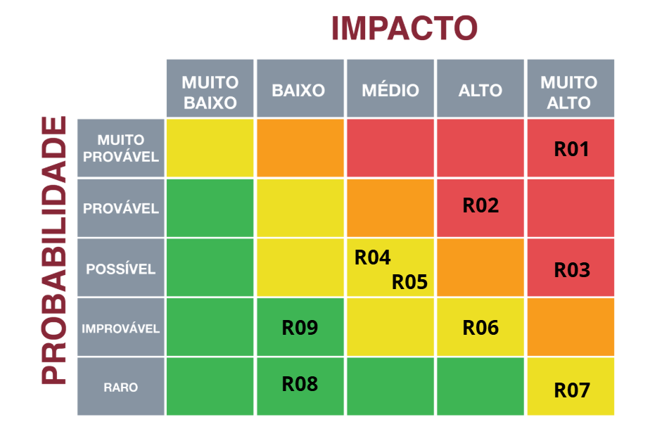
  <p>Fonte: material produzido pelos autores (2026).</p>
</div>
<br>

🔴 **R01 – Bugs nas mecânicas dos minigames**

&ensp;Os bugs nas mecânicas possuem alto impacto, pois comprometem diretamente a jogabilidade e podem impedir o jogador de concluir tarefas básicas, como finalizar um minigame. Como essas mecânicas são o núcleo do jogo, qualquer falha afeta a experiência como um todo.  

**Ação de mitigação:** realizar testes contínuos a cada sprint e validar cada mecânica individualmente antes de integrá-la ao jogo completo.

🔴 **R02 – Problemas com eventos de input (mouse/teclado)**

&ensp;Esse risco tem alto impacto, pois o jogo depende totalmente da interação do usuário. Caso cliques ou comandos não funcionem corretamente, o jogador não consegue jogar, tornando o sistema inutilizável.  

**Ação de mitigação:** testar todos os inputs de forma isolada e revisar constantemente os eventos (como pointerdown e teclado) durante o desenvolvimento.

🔴 **R03 – Dificuldade no uso do Phaser**

&ensp;O uso do Phaser apresenta alto impacto, pois é a principal tecnologia do projeto. Dificuldades na ferramenta podem atrasar o desenvolvimento, gerar erros frequentes e limitar a implementação das funcionalidades planejadas.  

 **Ação de mitigação:** estudar a documentação oficial, buscar tutoriais e dividir o desenvolvimento em pequenas entregas para facilitar o aprendizado progressivo.

🟡 **R04 – Assets não carregarem corretamente**

&ensp;Esse risco tem impacto médio, pois, embora não impeça totalmente o funcionamento do jogo, compromete a parte visual e pode gerar erros de execução. A ausência de imagens ou sons prejudica a experiência do usuário.  

**Ação de mitigação:** organizar corretamente os arquivos e garantir que todos os assets sejam carregados na função de preload antes de serem utilizados.

🟡 **R05 – Erros de posicionamento e escala de sprites**

&ensp;O impacto é médio, pois afeta a qualidade visual e a clareza das interações, podendo confundir o jogador, mas sem necessariamente travar o jogo.  

 **Ação de mitigação:** padronizar resoluções dos sprites, testar diferentes escalas no canvas e ajustar posicionamentos durante o desenvolvimento.

🟡 **R06 – Erro na transição entre cenas**

&ensp;Esse risco possui impacto médio, pois pode causar falhas na navegação do jogo, como travamentos ou telas que não carregam corretamente, prejudicando a continuidade da experiência.  

 **Ação de mitigação:** padronizar a lógica de troca de cenas e testar o fluxo completo do jogo com frequência.

🟢 **R07 – Incompatibilidade de código ou erros inesperados**

&ensp;Apesar de poder gerar problemas sérios, esse risco tem baixo controle e ocorrência menor, sendo classificado como impacto controlado. Geralmente são erros pontuais que podem ser corrigidos ao longo do desenvolvimento.  

 **Ação de mitigação:** utilizar versionamento com Git e realizar commits frequentes para facilitar a identificação e correção de erros.

🟢 **R08 – Pequenos bugs visuais (não críticos)**

&ensp;Esse risco tem baixo impacto, pois não impede o funcionamento do jogo, afetando apenas detalhes estéticos. Ainda assim, pode prejudicar levemente a percepção de qualidade.  

**Ação de mitigação:** revisar a interface visual nas etapas finais e corrigir inconsistências antes da entrega.

🟢 **R09 – Ajustes finos de interface (HUD/sprites)**

&ensp;O impacto é baixo, pois são ajustes de refinamento que não comprometem a funcionalidade do jogo, mas contribuem para uma melhor experiência do usuário.  

**Ação de mitigação:** reservar tempo no final do projeto para polimento visual e organização das informações na tela.


### 1.1.7. Objetivos, Metas e Indicadores 

&ensp;Para garantir que o jogo não seja apenas uma experiência de entretenimento, mas também uma extensão estratégica do pilar social **Cobasi Cuida**, os objetivos do projeto foram definidos com base na metodologia SMART (Específico, Mensurável, Alcançável, Relevante e Temporal). As metas estão organizadas em três eixos centrais: Impacto Social, Engajamento com a Marca e Qualidade Técnica.

**Objetivo 1: Impacto Social e Educação (Alinhado ao Cobasi Cuida)**
* **Específico (S):** Promover a conscientização dos usuários sobre as responsabilidades no cuidado animal e a importância da adoção responsável, por meio de mecânicas interativas de higiene, alimentação e saúde.
* **Mensurável (M):** Atingir uma taxa de acerto superior a 75% na primeira tentativa do minigame/quiz de alimentação correta e garantir que 90% dos testadores alcancem a mensagem de conscientização sobre devolução de animais.
* **Alcançável (A):** O uso de feedback visual imediato (HUD de status do pet) e um design focado na empatia facilita a compreensão do conteúdo educativo de forma acessível.
* **Relevante (R):** Alinha-se ao propósito do programa *Cobasi Cuida*, contribuindo para a formação de usuários mais conscientes e reduzindo a desinformação relacionada ao abandono ou devolução de animais.
* **Temporal (T):** Validação das métricas de aprendizado durante as sessões de *playtest* nas Sprints 4 e 5.

* **Indicadores (KPIs):**
  * Taxa de acerto nos minigames educativos (Meta: > 75%).
  * Porcentagem de jogadores que completam o ciclo de resgate do primeiro animal (Meta: > 90%).

---

**Objetivo 2: Engajamento e Afinidade de Marca (Brand Equity)**
* **Específico (S):** Reter o jogador no ciclo principal do jogo (*core loop*), fortalecendo o vínculo com o pet virtual e promovendo uma percepção positiva da marca Cobasi.
* **Mensurável (M):** Manter um tempo médio de sessão superior a 5 minutos e alcançar uma taxa de conversão de 80% no uso das moedas virtuais na loja do jogo.
* **Alcançável (A):** A mecânica de recompensas baseada no cuidado adequado do pet incentiva a progressão contínua do jogador.
* **Relevante (R):** Amplia a exposição da marca junto a um público digital, aproximando a experiência virtual do contexto real de consumo.
* **Temporal (T):** Coleta e análise dos dados a partir do MVP, com validação final na Sprint 5.

* **Indicadores (KPIs):**
  * Tempo médio de sessão por jogador (Meta: > 5 minutos).
  * Taxa de engajamento com a economia interna do jogo (Meta: 80% dos jogadores realizam ao menos uma ação de compra).

---

**Objetivo 3: Viabilidade e Usabilidade Técnica**
* **Específico (S):** Desenvolver um web game acessível, leve e com controles responsivos, compatível com os principais navegadores, sem necessidade de instalação.
* **Mensurável (M):** Alcançar pontuação superior a 80 na escala SUS (System Usability Scale) e ausência de bugs críticos na versão final.
* **Alcançável (A):** O escopo foi delimitado para um jogo 2D do tipo *point-and-click*, focado nas mecânicas essenciais.
* **Relevante (R):** A qualidade técnica do sistema deve refletir a confiabilidade da marca, evitando falhas que comprometam a experiência do usuário.
* **Temporal (T):** Entrega da versão final estável ao término do módulo.

* **Indicadores (KPIs):**
  * Pontuação na escala SUS (Meta: > 80/100).
  * Quantidade de bugs críticos na versão final (Meta: 0).


## 1.2. Requisitos do Jogo

&ensp;Os requisitos do jogo foram definidos para estruturar a experiência do jogador a partir da mecânica central de cuidado com animais domésticos, garantindo alinhamento entre jogabilidade e propósito social. O jogo deverá possuir gatos e cães como espécies principais, delimitando o universo temático e aproximando a experiência da realidade dos animais mais adotados. Essa escolha fortalece a proposta de conscientização sobre responsabilidade no cuidado e na adoção.

<div align="center">

\# | Quadro 1- Requisitos Funcionais do projeto
| :---: | :---: |
1 | O jogo deve possuir cães como animais disponíveis.
2 | A tela inicial do jogo deve possuir botões de "Jogar", "Tutorial", "Sair" e um ícone de engrenagem para configurações.
3 | Ao clicar em "Jogar" pela primeira vez, o jogo deve iniciar uma cutscene interativa mostrando a história do primeiro resgate.
4 | A cutscene deve possuir botões para avançar e voltar nas cenas da história.
5 | Após a cutscene, o jogo deve transicionar para uma tela com HUD mostrando os status do cachorro (Felicidade, Fome, Limpeza e Saúde).
6 | A tela do jogo deve conter botões interativos que levam às áreas responsáveis por melhorar cada status do animal.
7 | O jogador deve cuidar do animal (lavar, alimentar, medicar, brincar, etc.) para progredir no jogo.
8 | A mecânica principal do jogo deve ser o cuidado com animais resgatados em más condições.
9 | Em determinado momento do jogo, o jogador encontrará um animal já limpo, acompanhado de uma mensagem de conscientização sobre devolução de animais adotados.
10 | O jogo deve possuir um cenário específico localizado em uma área de banho.
11 | O jogador deve ganhar moedas ao tratar os animais, que poderão ser usadas para melhorias.
12 | O jogo deve possuir uma cena de banho onde o jogador pode remover sujeira através de interações como esfregar, enxaguar e aplicar shampoo.
13 | O animal só será considerado limpo após uma quantidade mínima de sabão ser aplicada.
14 | O jogador deve ensaboar, enxaguar e secar o animal para completar o processo de limpeza.
15 | O jogo deve possuir uma área específica para alimentação.
16 | Na área de alimentação o jogador deve ter acesso a diferentes tipos de ração com descrição de cada uma.
17 | A área de alimentação deve possuir uma estante clicável contendo as rações disponíveis.
18 | A área de alimentação deve conter um quiz educativo sobre alimentação correta de animais.
19 | Após acertar a ração correta, o jogo deve iniciar o "mini-game da ração".
20 | No mini-game da ração, pacotes de ração e chocolates devem cair na tela.
21 | No mini-game da ração, os pacotes de ração devem fornecer pontos e os chocolates devem fazer o jogador perder vida.
22 | O jogador deve possuir 3 vidas no mini-game da ração, finalizando ao perder todas ou ao clicar na seta de voltar.
23 | O jogo deve possuir uma área de cuidados.
24 | A área de cuidados deve possuir um mini-game para retirada de pulgas.
25 | O mini-game das pulgas deve avaliar a velocidade com que o jogador remove todas as pulgas.
26 | O jogo deve possuir uma área de lazer para os animais.

</div>

<div align="center">

\# | **Quadro 2- Requisitos Não Funcionais do projeto**
| :---: | :---: |
1 | O jogo deve possuir indicação visual no cursor do mouse para áreas interativas.
2 | A cena de banho deve possuir feedback visual, como espuma, água escorrendo e reação positiva do animal.
3 | O jogo deve possuir interface intuitiva, permitindo que o jogador compreenda as ações disponíveis sem necessidade de explicações complexas.
4 | O jogo deve apresentar tempo de carregamento reduzido entre as cenas, garantindo fluidez na experiência do jogador.
5 | O jogo deve possuir organização visual clara da HUD, permitindo que o jogador visualize facilmente os status do animal.
6 | O jogo deve manter consistência visual entre cenários, menus e elementos gráficos.
7 | O jogo deve possuir controles responsivos, garantindo que as ações do jogador sejam executadas rapidamente após a interação.
8 | O jogo deve possuir compatibilidade com resolução de tela padrão de computadores, mantendo a interface corretamente ajustada.
9 | O jogo deve manter desempenho estável, evitando travamentos ou quedas significativas de desempenho durante a execução.
10 | O jogo deve apresentar textos e informações legíveis, utilizando fontes e tamanhos adequados para facilitar a leitura pelo jogador.

</div>

<div align="center">
  <p>Feito pela própria equipe (2026)</p>
</div>

**Requisitos Funcionais:** São os requisitos que o sistema faz.
Descrevem as funcionalidades, ações e comportamentos esperados.

**Exemplo:** No requisito 3, o sistema deverá permitir que o jogador trate do animal, realizando ações como lavar, alimentar, medicar e brincar, com o objetivo de fazer o jogador progredir no jogo. Para isso, o sistema apresentará animais com diferentes necessidades e disponibilizará interações específicas para que o jogador resolva cada uma delas.

**Requisitos Não Funcionais:** São os requisitos que descrevem como o sistema deve ser ou como ele deve funcionar, mas não são funcionalidades diretas.

**Exemplo:** No requisito 10, a Cena de Banho deverá apresentar feedback visual durante as interações realizadas pelo jogador, permitindo que ele perceba claramente o progresso da limpeza do animal. Durante esse processo, ao aplicar sabão deverá surgir espuma sobre o animal, ao enxaguar deverão aparecer efeitos de água escorrendo e, conforme a sujeira for removida, o animal deverá demonstrar reações positivas, como expressões de satisfação ou mudanças em sua aparência.

&ensp;Os requisitos não operam de forma isolada, mas de maneira articulada. A definição das espécies estabelece o escopo temático; a mecânica de cuidado estrutura a jogabilidade; os cenários organizam as ações; o sistema de moedas promove progressão; a indicação visual aprimora a interação; e o momento de conscientização consolida o propósito social do projeto. O desenvolvimento será realizado de forma incremental nas sprints iniciais, priorizando a implementação da mecânica central e das interações básicas, e posteriormente incorporando o sistema de recompensas e o evento educativo, garantindo viabilidade técnica e coerência na evolução do jogo.

## 1.3. Público-alvo do Projeto

&ensp;O Público alvo do nosso projeto é qualquer um que tenha interesse em aprender e dar uma qualidade de vida melhor ao seu Pet. Apesar de ser acessível para qualquer um, é previsto que a Geração Z tenha mais contato com o jogo pela seu apreço com jogos e pela crescente onda de pais de pets entre essa geração.

--- 
# 2. Visão Geral do Jogo 

## 2.1. Objetivos do Jogo

&ensp;O jogo tem como objetivo central promover o cuidado e o bem-estar dos animais,com foco especial nos cães,em  sintonia com o projeto Cobasi Cuida. A experiência é estruturada em fases progressivas, cada uma trazendp novos desafios e diferentes perfis de pets, que variam em raça, porte, idade e peso.

&ensp;Ao longo da jornada, o jogador assume o papel de cuidador responsável e, para avançar, deve realizar uma série de atividades interativas por meio de minigames. Essas dinâmicas simulam tarefas essenciais de cuidado, como encher o pote de ração, oferecer brinquedos, dar banho e proporcionar momentos de lazer. Cada ação concluida contribui para o aumento da barra de felicidade, um indicador visual que demonstra o nível de satisfação e bem-estar do animal.

&ensp;O progresso do jogador é medido por sua capacidade de manter os cães felizes e saudáveis. A cada animal bem cuidado, ele recebe moedas virtuais como recompensa. Essas moedas desempenham um papel estratégico no jogo, pois permitem a compra de rações e equipamentos melhores, que facilitam os cuidados nas fases seguintes, além da aquisição de acessórios e itens de personalização, que tornam a experiência mais divertida e possibilitam enfeitar os animaisTambém servem para desbloquear novos conteúdos e desafios, ampliando a diversidade de cães e de atividades disponíveis. 

&ensp;Dessa forma, os objetivos do jogo se dividem em duas frentes principais: A primeira é garantir garantir o cuidado adequado dos animais, mantendo a barra de felicidade sempre elevada. A segunda é acumular moedas para investir em melhorias, acessórios e desbloqueios, tornando a jornada mais dinâmica e recompensadora.


## 2.2. Características do Jogo

### 2.2.1. Gênero do Jogo

 O gênero do jogo é simulação, pois o jogador assume o papel de um voluntário do projeto Cobasi Cuida, responsável por cuidar de diferentes cães em situações variadas. A proposta é reproduzir, de forma lúdica e interativa, a experiência de oferecer atenção, carinho e cuidados básicos aos animais, aproximando o jogador da realidade de quem atua em abrigos ou projetos de adoção.

Dentro do gênero de simulação, o jogo incorpora elementos de progressão e personalização, permitindo que o jogador evolua à medida que realiza os cuidados e acumula moedas virtuais. Essa mecânica aproxima o jogo de características de um RPG leve, já que há evolução de recursos, desbloqueio de fases e aquisição de itens que aprimoram a experiência.

Além disso, o jogo pode ser classificado como casual, pois apresenta minigames acessíveis e intuitivos, voltados para públicos diversos, sem exigir domínio de controles complexos ou estratégias avançadas. O foco está na diversão, na sensação de responsabilidade e na recompensa emocional de ver os animais felizes.

### 2.2.2. Plataforma do Jogo

 O jogo será disponibilizado para desktop, com execução diretamente em navegadores web modernos, como Google Chrome, Microsoft Edge, Safari e Opera. Essa escolha de plataforma garante maior acessibilidade e praticidade, já que não será necessário instalar programas adicionais nem realizar downloads complexos.

A opção pelos navegadores permite que o jogo seja multiplataforma, funcionando em diferentes sistemas operacionais, como Windows, macOS e Linux, desde que o usuário tenha acesso a um navegador compatível. Além disso, essa abordagem facilita a atualização contínua do jogo, pois qualquer melhoria ou correção pode ser aplicada diretamente no servidor, sem exigir que o jogador baixe novas versões.

Outro ponto importante é que a execução em navegadores torna o jogo mais inclusivo e acessível, permitindo que seja jogado em computadores com diferentes níveis de desempenho, sem exigir configurações avançadas de hardware.

### 2.2.3. Número de jogadores

 O jogo foi projetado para apenas um jogador, com o objetivo de fortalecer o vínculo individual entre o cuidador e os animais. Essa escolha garante um maior senso de responsabilidade, já que cada decisão e ação realizada impacta diretamente o bem-estar dos cães.

A experiência single-player também permite que o jogador se envolva de forma mais imersiva e pessoal, sem distrações externas, reforçando a proposta central do projeto Cobasi Cuida: estimular a empatia, o cuidado e a dedicação aos animais.

### 2.2.4. Títulos semelhantes e inspirações

#### 2.2.4.1 Meu Talking Tom - Android ou iOS

É a principal inspiração para o nosso protótipo. Trata-se de um jogo simples, cujo objetivo é cuidar do Tom.

*Ideias de funcionalidades:*

* Toque interativo, permitindo tocar no pet e observar sua reação.
* O pet ouvir a fala do jogador e reproduzi-la com uma voz diferente.
* Vestir o pet.
* Alimentar o pet com diferentes alimentos, e não apenas ração ou sachês.
* Sistema de nível do pet, em que o progresso aumenta conforme as atividades são realizadas, com possível integração à ideia de fases.
* Troca de ambientação, como sala, quarto, banheiro, quintal, parque e loja.
* Estilo de interface com indicadores como felicidade, fome, sede, sono e energia.

#### 2.2.4.2 Nintendogs - Nintendo DS/3DS

* Referência em funcionalidades de cuidado com o pet.
* O pet reage às ações do jogador, e sua aparência muda conforme o nível de cuidado, podendo ficar sujo, limpo, feliz ou triste.
* A tela sensível ao toque é utilizada para acariciar o pet.
* O jogo inclui diversas raças de cães e gatos.

#### 2.2.4.3 Animal Shelter Simulator - Google Play e iOS

A proposta do jogo é administrar um abrigo, envolvendo tarefas operacionais e o cuidado com os animais.

* Loop de tarefas, como higiene, alimentação e rotina.
* Progressão por meio de desbloqueios e expansão.

### 2.2.5 Tempo estimado de jogo

 O tempo estimado de gameplay para o *Cobasi Shelter*, considerando a familiaridade do público-alvo com videogames, varia entre quatro e dez minutos. É provável, no entanto, que, com futuras alterações e melhorias, a complexidade do jogo aumente e, consequentemente, o tempo de gameplay também seja ampliado.

--- 
# 3. Game Design

## 3.1. Enredo do Jogo

&ensp;O jogo se passa no contexto de uma unidade da Cobasi, onde o jogador assume o papel de um cuidador responsável por animais resgatados. A experiência se inicia quando o usuário chega ao local com um cachorro abandonado, sendo recepcionado por Maycon, o Personal Pet, que introduz o jogador às atividades e responsabilidades dentro do ambiente.

&ensp;A narrativa é construída a partir da jornada de recuperação do animal, que passa por diferentes etapas de cuidado até estar pronto para adoção. Cada etapa é representada por um minigame, que simula situações reais do dia a dia de um tutor responsável.

**Mini Game 1: Banho** 

&ensp;No primeiro desafio, o jogador deve realizar a higiene completa do cachorro. Para isso, utiliza três ferramentas principais: o chuveiro, a barra de sabão e a toalha.

&ensp;O objetivo é seguir a sequência correta de limpeza (molhar o Pet, ensaboar, enxaguar e secar) garantindo que o animal fique totalmente limpo. Esse Mini Game introduz o jogador às mecânicas básicas de interação e reforça a importância da higiene para a saúde do pet.

**Mini Game 2: Alimentação**

&ensp;O segundo momento do jogo é dividido em duas etapas.

&ensp;Na primeira, o jogador deve selecionar e efetuar a compra da ração correta para o cachorro. Essa escolha é fundamental, pois impacta diretamente a próxima fase do minigame. Caso escolha corretamente, ele avança para a fase principal.

&ensp;Na segunda etapa, o jogador controla o cachorro utilizando as setas do teclado, movimentando-o lateralmente para capturar os alimentos que caem na tela. Diferente da versão anterior, a ração que aparece é exclusivamente aquela que o jogador escolheu e comprou na etapa inicial.

&ensp;Ao mesmo tempo, continuam surgindo alimentos prejudiciais, como chocolate, que devem ser evitados. O desafio consiste em equilibrar rapidez e precisão, garantindo que o animal consuma apenas os itens adequados e desvie dos elementos perigosos.

**Mini Game 3: Cuidados**

&ensp;Nesta fase, o jogador precisa cuidar da saúde do animal, removendo todas as pulgas presentes em seu pelo.

&ensp;O processo acontece em duas etapas:

* Aplicação do spray sobre as pulgas
* Remoção utilizando a pinça

&ensp;O jogador deve completar ambas as ações corretamente para eliminar completamente os parasitas. Esse minigame reforça a importância dos cuidados veterinários e da atenção aos detalhes.

**Mini Game 4: Lazer**

&ensp;O último minigame representa um momento de lazer e interação entre o jogador e o animal, após os cuidados básicos terem sido realizados.

&ensp;A fase consiste em uma corrida de obstáculos, onde o jogador deve executar comandos para fazer com que o cachorro:
- Desvie dos obstáculos
- Colete ossos saudáveis
- Evite ossos estragados

&ensp;Esse momento simboliza a recuperação do animal e o fortalecimento do vínculo com o cuidador, além de trazer dinamismo e diversão para a experiência.


## 3.2. Personagens

### 3.2.1. Controláveis

&ensp;O jogador assume o papel de um cuidador, representando o próprio usuário dentro do jogo. Esse personagem é responsável por realizar todas as ações relacionadas ao cuidado dos animais, sendo o principal agente da experiência.

* Nome: Cuidador (avatar do jogador)
* Objetivo: Cuidar dos animais resgatados e prepará-los para adoção
* Características: Atento, responsável e empático
* Habilidades:  
  * Realizar atividades de cuidado (banho, alimentação e tratamento).   
  * Interagir com objetos do ambiente. 
  * Tomar decisões rápidas durante os minigames

### Animais (Personagens Centrais)
&ensp;Os animais são parte essencial da experiência, funcionando como personagens com identidade própria e evolução ao longo do jogo.

**Adriel**

- Primeiro cachorro apresentado ao jogador;
- Personagem original criado pelo grupo;
- Representa o início da jornada de aprendizado do jogador.

**Herói**
- Baseado em um animal real da plataforma Cobasi Cuida;
- Possui uma característica marcante: não possui um dos olhos;
- Representa a realidade de muitos animais resgatados, trazendo um forte apelo emocional e conscientização.

**João**
- Também presente na plataforma Cobasi Cuida;
- Não possui nenhuma deficiência física;
- Representa um perfil mais comum de animal disponível para adoção.
 
### 3.2.2. Non-Playable Characters (NPC)

&ensp;O jogo conta com NPCs que enriquecem a narrativa e reforçam o contexto do universo da Cobasi.

**Maycon — Personal Pet**

&ensp;Maycon é o principal NPC do jogo e atua como um Personal Pet, sendo responsável por recepcionar o jogador logo no início da experiência, quando o usuário chega à loja da Cobasi com um animal resgatado.

&ensp;Ele funciona como um guia, introduzindo o jogador às mecânicas do jogo e orientando sobre os cuidados necessários com o pet.

- **Função:** Tutorial e guia do jogador
- **Características:** Prestativo, acolhedor e didático
- **Diferencial:** Utiliza um colar que representa o espectro autista, contribuindo para a inclusão e representatividade dentro do jogo.

&ensp;Sua presença fortalece a conexão emocional do jogador com o ambiente e torna a experiência mais humanizada.

### 3.2.3. Diversidade e Representatividade dos Personagens

&ensp;A diversidade e a inclusão são elementos cada vez mais essenciais na indústria de jogos digitais, pois garantem representatividade, acessibilidade e identificação para diferentes perfis de jogadores. No contexto dos games, esses princípios envolvem a construção respeitosa de personagens, narrativas e mecânicas que contemplem múltiplas realidades sociais, culturais e individuais.

&ensp;Com base nessa compreensão, a diversidade e a inclusão foram incorporadas como pilares estratégicos no desenvolvimento deste projeto. A construção das personagens foi fundamentada em dados da realidade brasileira e alinhada ao público-alvo do jogo. A escolha de uma mulher jovem como protagonista baseia-se em pesquisas como o levantamento da Golden em parceria com a Opinion Box (2023), que aponta maior engajamento feminino na adoção responsável e na busca por animais em ONGs e abrigos, além da forte participação da Geração Z nesse movimento. Essa decisão fortalece a identificação entre jogador e protagonista, promovendo pertencimento e coerência com o perfil dos consumidores da marca Cobasi.

&ensp;Além disso, o personagem pet care foi desenvolvido com pele escura, reforçando a representatividade racial e ampliando a diversidade étnica dentro do universo do jogo. O personagem também utiliza o colar de identificação do autismo, símbolo associado à conscientização sobre o Transtorno do Espectro Autista (TEA), promovendo visibilidade à neurodiversidade de maneira respeitosa e não estereotipada. A proposta dialoga com princípios de equidade ao representar grupos historicamente invisibilizados de forma ativa e protagonista, indo além de uma diversidade apenas estética.

&ensp;Dessa forma, o impacto esperado é duplo: fortalecer o vínculo emocional com o público-alvo e posicionar o jogo como uma experiência transformadora que reflete a pluralidade da sociedade brasileira e os valores de responsabilidade, cuidado e inclusão associados à marca.


## 3.3. Mundo do jogo

### 3.3.1. Locações Principais e/ou Mapas 

&ensp;O jogo se passa em uma unidade da Cobasi adaptada para o cuidado de animais resgatados. O ambiente é dividido em diferentes áreas funcionais, cada uma representando uma etapa essencial da recuperação do pet, diretamente conectada aos minigames do jogo.

&ensp;As principais locações são:

**Área de Banho**     
&ensp;O background é representado por um banheiro, espaço destinado à higiene do animal, equipado com chuveiro, sabonete e toalha. Este ambiente é utilizado no primeiro minigame, onde o jogador realiza a limpeza completa do cachorro.

**Área de Alimentação**       
&ensp;Ambiente onde ocorre tanto a escolha da ração quanto a alimentação do animal. Inicialmente, o jogador seleciona o tipo de ração adequado, e em seguida participa da fase dinâmica onde o cachorro coleta os alimentos corretos e desvia dos que são prejudiciais à saúde dele.

**Área de Cuidados (Veterinário)**    
&ensp;Local voltado para o tratamento do animal, especialmente a remoção de parasitas. O background é inspirado em uma sala de veterinário. Assim que o usuário começa o Mini Game, ele é redirecionado a uma tela onde demos um zoom no pelo do Pet. Essa tela contém ferramentas como spray e pinça, utilizadas para eliminar as pulgas.

**Área de Lazer**   
&ensp;Espaço destinado à interação e recreação com o animal. Esse ambiente é inteiro inspirado no espaço Pet da loja da Cobasi, colocamos a logo da empresa no fundo da tela, fazendo com que ele apareça sempre durante a corrida de obstáculos. Representa a fase final da jornada, onde o jogador participa de um Mini Game interativo, simbolizando a recuperação e bem-estar do pet.


### 3.3.2. Navegação pelo mundo 

&ensp;A navegação no jogo ocorre por meio de uma interface central (HUD), onde o jogador seleciona os Mini Games disponíveis.

&ensp;O fluxo de progressão é estruturado de forma sequencial:

1. O jogador inicia na recepção com o NPC Maycon;
2. A partir daí, acessa os minigames conforme a ordem de cuidado do animal;
3. Ao finalizar uma atividade, o jogador retorna ao menu principal.

&ensp;Dentro dos minigames, a movimentação varia conforme a mecânica:
- Uso do mouse para interações (banho e cuidados);
- Uso do teclado para movimentação (alimentação e lazer).

&ensp;Esse sistema garante uma progressão guiada, intuitiva e alinhada com a narrativa do jogo.


### 3.3.3. Condições climáticas e temporais 

&ensp;O jogo não apresenta variações climáticas, pois todas as atividades ocorrem em ambientes internos controlados.

&ensp;No entanto, o fator tempo é utilizado como elemento de desafio em determinadas fases:

- No minigame de alimentação, a velocidade de queda dos itens exige rapidez do jogador;
- No minigame de lazer, o ritmo da corrida aumenta progressivamente;
- Algumas ações exigem execução dentro de um tempo ideal para melhor desempenho.

&ensp;Dessa forma, o tempo atua como um mecanismo de dificuldade e engajamento, incentivando o jogador a melhorar sua performance.


### 3.3.4. Concept Art 

&ensp;A concept art é uma etapa do desenvolvimento de jogos voltada à definição visual de personagens, cenários e elementos interativos, servindo como guia para a direção artística do projeto. Segundo Schell (2019), a visualização prévia contribui para alinhar a proposta estética entre os membros da equipe. Assim, as concept arts deste jogo foram elaboradas para evidenciar seus principais componentes visuais.

<br>
<div align="center">
<p>Figura 4: Tela de menu principal do jogo.</p>

<p>Fonte: material produzido pelos autores (2026).</p>
</div>
<br>

<br>
<div align="center">
<p>Figura 5: HUD com botões que redirecionam para as telas de banheiro, alimentação, saúde e lazer do pet.</p>
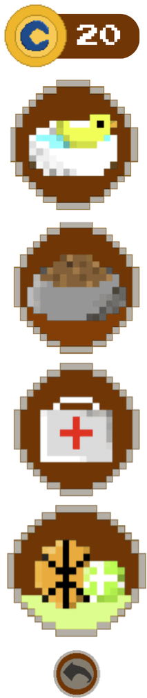
<p>Fonte: material produzido pelos autores (2026).</p>
</div>
<br>

<br>
<div align="center">
<p>Figura 6: Tela do banheiro, apresentando o pet no ambiente de higiene com itens interativos.</p>
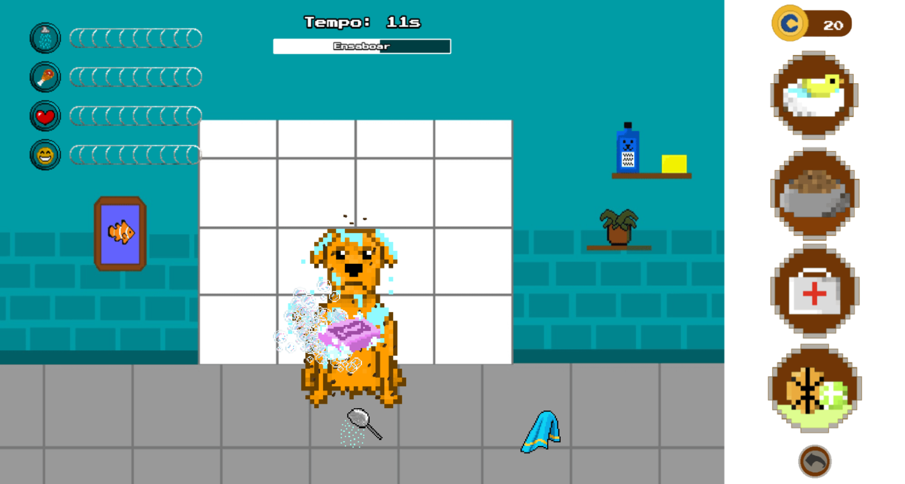
<p>Fonte: Produzido pelos autores (2026)</p>
</div>
<br>

<br>
<div align="center">
<p>Figura 7: Personagem protagonista do jogo, representada por uma mulher jovem e empoderada que cuidará dos pets.</p>
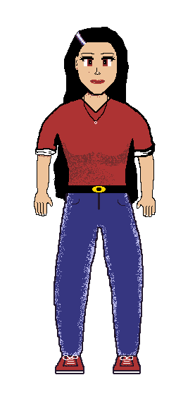
<p>Fonte: material produzido pelos autores (2026).</p>
<br>

</div>


<br>

<div align="center">
<p>Figura 8: Personal Pet, personagem secundário do jogo, responsável por auxiliar o jogador durante a narrativa do jogo.</p>
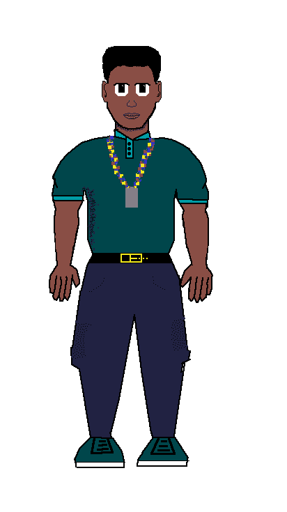
<p>Fonte: material produzido pelos autores (2026).</p>

</div>
<br>

### 3.3.5. Trilha Sonora
&ensp; A trilha sonora do jogo é composta por faixas originais criadas exclusivamente para o projeto, garantindo uma identidade sonora autêntica e perfeitamente alinhada à atmosfera do jogo. O foco atual da composição é estabelecer o tom correto nos primeiros contatos do jogador com a obra, criando imersão desde o menu inicial e ajudando a contar a história durante a introdução narrativa. As faixas presentes até o momento estão organizadas na tabela abaixo:

<div align="center">

\# | titulo | ocorrência | autoria
| :---: | :---: | :---: | :---: |
1 | Adotando e Cuidando | Menu Principal | Composição Própria (Gustavo Fantasia)
2 | Patas na Chuva | Cutscene pós menu principal | Composição Própria (Gustavo Fantasia) 

</div>

## 3.4. Inventário e Bestiário
*Não se aplica ao projeto*

## 3.5. Gameflow

&ensp;No desenvolvimento de jogos, o diagrama de cenas é uma ferramenta visual utilizada no GDD (Game Design Document) para organizar e representar a estrutura do jogo. Ele mostra, de forma esquemática, todas as telas ou cenas existentes — como menu inicial, tutorial, fases, configurações, pausa e game over (e como elas se conectam entre si).

&ensp;Esse diagrama ajuda a equipe a entender o fluxo de navegação do jogador, indicando quais ações levam de uma cena para outra. Além disso, facilita o planejamento da programação, da interface e da experidência do usuário, evitando erros de estrutura e retrabalho. Assim, o diagrama de cenas funciona como um “mapa” do jogo, tornando o projeto mais claro, organizado e eficiente durante o desenvolvimento.Para acessar o diagrama completo em alta resolução, clique na imagem que o redirecionará pra 

<div align="center">
  <p>Figura 9: Diagrama de Cenas Completo</p>
  <a href="https://miro.com/app/board/uXjVGlD-iZU=/?share_link_id=746686012773">
    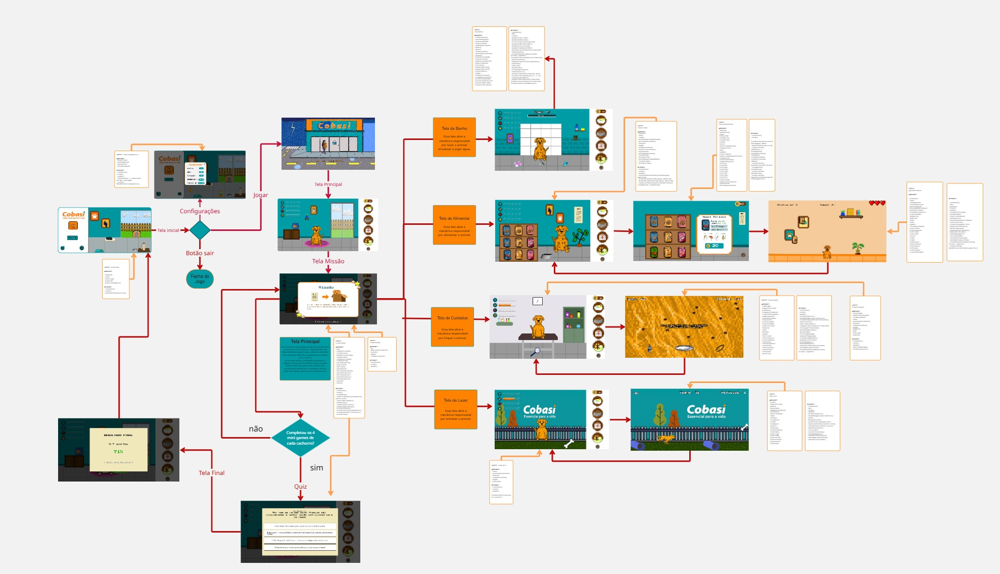
  </a>
  <p>Feito pela própria equipe(2026)</p>


  <p>Figura 10: Diagrama de Cenas - Parte 1</p>
  <a href="https://miro.com/app/board/uXjVGlD-iZU=/?share_link_id=746686012773">
    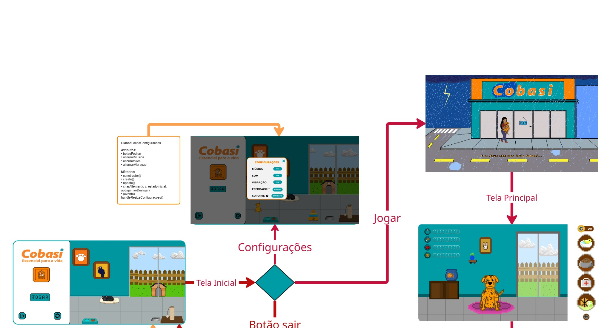
  </a>
  <p>Feito pela própria equipe(2026)</p>

   <p>Figura 11: Diagrama de Cenas - Parte 2</p>
  <a href="https://miro.com/app/board/uXjVGlD-iZU=/?share_link_id=746686012773">
    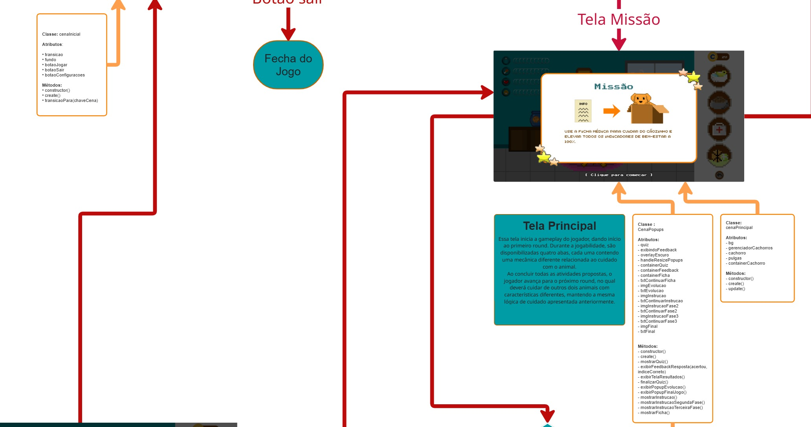
  </a>
  <p>Feito pela própria equipe(2026)</p>

   <p>Figura 12: Diagrama de Cenas - Parte 3</p>
  <a href="https://miro.com/app/board/uXjVGlD-iZU=/?share_link_id=746686012773">
    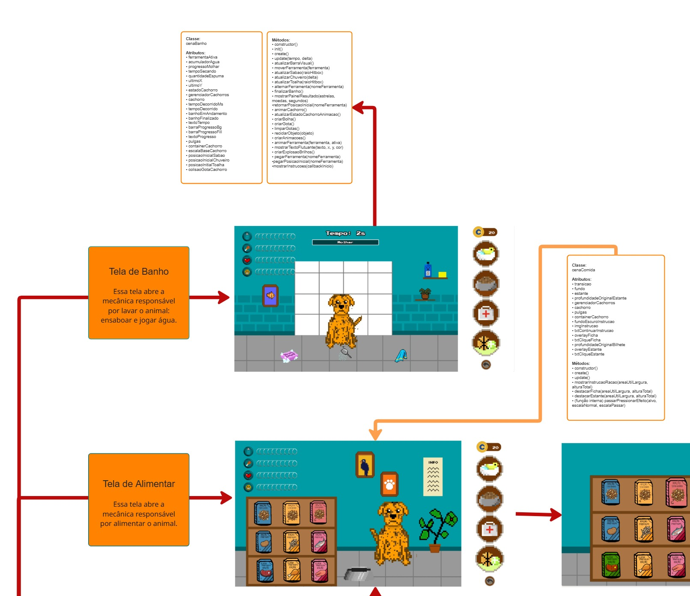
  </a>
  <p>Feito pela própria equipe(2026)</p>

   <p>Figura 13: Diagrama de Cenas - Parte 4</p>
  <a href="https://miro.com/app/board/uXjVGlD-iZU=/?share_link_id=746686012773">
    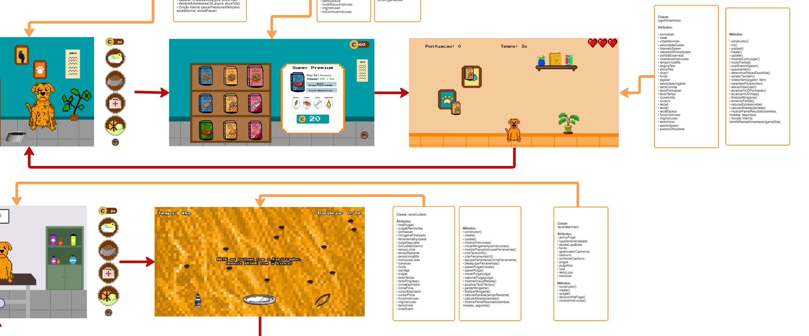
  </a>
  <p>Feito pela própria equipe(2026)</p>

   <p>Figura 14: Diagrama de Cenas- Parte 5</p>
  <a href="https://miro.com/app/board/uXjVGlD-iZU=/?share_link_id=746686012773">
    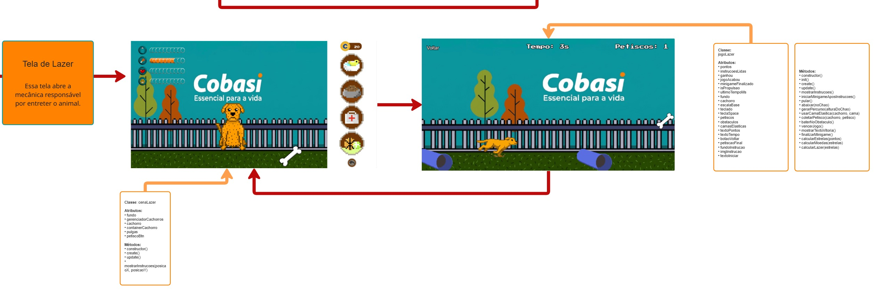
  </a>
  <p>Feito pela própria equipe(2026)</p>


</div>

## 3.6 Regras do Jogo 

&ensp;O jogo é composto por diferentes minigames que simulam atividades de cuidado com um animal doméstico. Em cada minigame, o jogador deve executar ações específicas para cumprir os objetivos propostos. Ao concluir cada atividade com sucesso, o jogador recebe CobasiCoins, que funcionam como indicador de progresso e incentivam a continuidade da experiência.

&ensp;As regras são apresentadas gradualmente por meio de pop-ups informativos exibidos ao acessar cada cena pela primeira vez, permitindo a compreensão adequada das mecânicas e dos objetivos de cada atividade.

### 3.6.1 Minigame de Banho

&ensp;No minigame de banho, o jogador deve realizar a limpeza completa do cachorro utilizando três ferramentas: sabão, chuveiro e toalha. O processo deve seguir uma ordem sequencial obrigatória.

&ensp;Inicialmente, o jogador deve aplicar o sabão sobre o animal, gerando bolhas que representam a remoção da sujeira. Após atingir o limite de aplicação do sabão, o sistema apresenta um aviso indicando a necessidade de utilização do chuveiro.

&ensp;Em seguida, o jogador deve utilizar o chuveiro para remover completamente o sabão por meio de uma animação de água. Após a remoção total das bolhas, o cachorro permanece molhado, sendo necessário utilizar a toalha para secá-lo.

&ensp;O sistema impede a utilização das ferramentas fora da ordem estabelecida, apresentando mensagens de orientação ao jogador. O minigame é concluído apenas quando o animal se encontra totalmente limpo e seco. Ao final, o jogador recebe 20 CobasiCoins e ocorre a atualização da barra de felicidade.

### 3.6.2 Minigame de Alimentação

&ensp;Na escolha de rações, o jogador deve comprar o tipo de ração para o cachorro (Standard, Premium e Super Premium) baseando-se na ficha de informações dele.

&ensp;No mini game de alimentação, o jogador deve controlar o cachorro com o objetivo de coletar as rações e evitar chocolates. Durante a execução, rações e chocolates são lançados continuamente a partir da parte superior da tela.

&ensp;As rações são classificadas em três tipos de ração: Standard, Premium e Super Premium. Cada uma, ao completar o jogo preenche uma quantidade específica da barra de fome. 

* Standard: Preenche cinco (5) blocos da barra de fome;
* Premium: Preenche sete (7) blocos da barra de fome;
* Super Premium: Preenche dez (10) blocos da barra de fome;

&ensp;Itens prejudiciais, nesse caso os chocolates, também aparecem na tela e devem ser evitados. Cada coleta de um item prejudicial resulta na perda de uma vida. O jogador inicia o minigame com três vidas e, ao perder todas, a atividade é reiniciada.

&ensp;O objetivo consiste em atingir a pontuação de 150 pontos para concluir o minigame. Qualquer ração, independente do tipo, ao serem coletadas concedem 10 pontos.

&ensp;No sistema de compra, a ração Standard possui o custo de 10 CobasiCoins, a ração Premium possui o custo de 15 CobasiCoins e a SUper Premium o custo de 20 CobasiCoins.

&ensp;Ao alcançar a pontuação necessária, o jogador retorna à cena de alimentação, a barra de fome é atualizada e as moedas são ajustadas conforme a compra realizada.

### 3.6.3 Minigame Veterinário

&ensp;No minigame veterinário, o jogador deve remover as pulgas presentes no animal utilizando um remédio anti-pulgas e uma pinça. A interação consiste em neutralizar as pulgas e transportá-las até uma bandeja específica.

&ensp;A aplicação do remédio ocorre por meio da manutenção do clique do mouse, sendo que a pulga é neutralizada apenas quando o botão for pressionado.

&ensp;A captura ocorre por meio da manutenção do clique do mouse, sendo que a pulga permanece presa apenas enquanto o botão estiver pressionado. Caso o jogador solte o botão antes de posicionar a pulga na bandeja, ela retorna à sua última posição.

&ensp;O objetivo do minigame é coletar um total de 12 pulgas. Ao atingir esse valor, a atividade é encerrada, a barra de saúde é atualizada e o jogador retorna à cena principal de cuidados.

### 3.6.4 Minigame de Lazer

&ensp;No minigame de lazer, o jogador controla o cachorro em um cenário com movimentação automática, devendo realizar saltos para evitar obstáculos e coletar itens distribuídos ao longo do percurso.

&ensp;A colisão com obstáculos resulta na reinicialização do minigame. Os itens coletáveis apresentam efeitos distintos, sendo eles um osso e um osso podre, respectivamente aumentando e reduzindo a pontuação do jogador.

&ensp;Ao final da fase, o jogador deve coletar um item especial que encerra o minigame. O desempenho obtido influencia diretamente o preenchimento da barra de felicidade, sendo total quando a pontuação é igual ou superior a cinco pontos, e parcial quando inferior a esse valor.


## 3.7 Mecânicas do Jogo

### 3.7.1 Descrição Geral das Mecânicas

&ensp;As mecânicas do jogo definem as formas de interação entre o jogador e os elementos presentes em cada minigame. Essas interações ocorrem por meio do uso do mouse, para manipulação de objetos, e do teclado, para controle de movimentação.

&ensp;O sistema apresenta feedback visual contínuo, incluindo animações, alterações de escala e exibição de elementos informativos, com o objetivo de orientar o jogador durante a execução das atividades.

&ensp;O progresso do jogador é apresentado por meio de um HUD (Heads-Up Display), que exibe as CobasiCoins e as barras de bem-estar do animal, compreendendo os indicadores de higiene, alimentação, saúde e felicidade.

### 3.7.2 Mecânicas do Minigame de Banho

&ensp;No minigame de banho, o jogador interage exclusivamente com o mouse para selecionar e movimentar as ferramentas. O clique esquerdo permite selecionar e manter ativa a ferramenta, enquanto o movimento do cursor possibilita sua aplicação sobre o animal.

&ensp;A mecânica consiste na aplicação sequencial das ferramentas. O sabão gera bolhas ao ser utilizado, o chuveiro remove essas bolhas por meio de uma animação de água e a toalha realiza a secagem final do animal. O sistema controla a ordem de uso, impedindo ações incorretas e garantindo a execução adequada do processo.

### 3.7.3 Mecânicas do Minigame de Alimentação

&ensp;No minigame de alimentação, o controle do personagem é realizado por meio do teclado, utilizando as teclas direcionais para deslocamento horizontal.

&ensp;A mecânica baseia-se na coleta de itens que caem pela tela. Existem dois tipos de ração disponíveis: a ração Standard, que adiciona 10 pontos à pontuação do jogador, e a ração Super Premium, que adiciona 15 pontos e pode restaurar uma vida perdida.

&ensp;Itens prejudiciais, como chocolates, também estão presentes e devem ser evitados, pois causam a perda de uma vida ao serem coletados.

&ensp;O jogador inicia a partida com três vidas, sendo possível recuperar esse recurso por meio da coleta de rações específicas. A dinâmica do minigame exige movimentação constante e tomada de decisão rápida.

### 3.7.4 Mecânicas do Minigame Veterinário

&ensp;No minigame veterinário, a interação ocorre por meio do mouse, permitindo o jogador manipular o remédio para neutralizar e a pinça para capturar as pulgas. A movimentação da ferramenta acompanha o cursor, e a neutralização depende da manutenção do clique durante o deslocamento.

&ensp;A mecânica exige precisão no posicionamento e controle contínuo, uma vez que a neutralização da pulga só acontece quando o clique do remédio acontece exatamente na hitxbox determinada. 

### 3.7.5 Mecânicas do Minigame de Lazer

&ensp;No minigame de lazer, o jogador utiliza o teclado para realizar saltos enquanto o personagem se desloca automaticamente pelo cenário.

&ensp;A mecânica envolve tempo de reação para evitar obstáculos e coletar itens. Elementos específicos, como a cama elástica, permitem a execução de saltos com maior altura, ampliando as possibilidades de interação.

### 3.7.6 Progressão do Jogo

&ensp;A progressão do jogo é baseada no preenchimento das barras de bem-estar do animal, correspondentes aos aspectos de higiene, alimentação, saúde e felicidade.

&ensp;Cada minigame contribui diretamente para o preenchimento de uma dessas barras. Quando todas as barras são completamente preenchidas, um novo animal é disponibilizado ao jogador, reiniciando o ciclo de jogo.

&ensp;As mecânicas permanecem inalteradas no novo ciclo, garantindo a continuidade da experiência.

## 3.8. Implementação Matemática de Animação/Movimento

### 3.8.1 Parâmetros de entrada

&ensp;Nesta seção é apresentada a modelagem matemática responsável pela animação de deslocamento do personagem após a interação com a cama elástica localizada na área de lazer do jogo.

&ensp;É importante destacar que a cama elástica não constitui a mecânica principal do minigame. Ela atua exclusivamente como um evento de conclusão: após cumprir os objetivos propostos, o jogador aciona esse objeto e o personagem é impulsionado para outra posição do cenário. Essa animação serve como um feedback visual claro de término da atividade e transição para o próximo estado do jogo.

&ensp;O elemento gráfico modelado é o sprite do personagem (cachorro). A posição inicial corresponde exatamente às coordenadas ocupadas pelo personagem no instante do contato com a cama elástica.

&ensp;No código, essas posições são obtidas diretamente por:
<p align="center">x<sub>0</sub> = cachorro.x  </p>
<p align="center">y<sub>0</sub> = cachorro.y </p>

&ensp;Portanto, a posição inicial é dada por:

<p align="center">(x<sub>0</sub>  pixels, y<sub>0</sub> pixels)</p>

&ensp;A posição final não é fixa na tela, mas sim definida como um deslocamento relativo, garantindo que a animação funcione corretamente independentemente da posição em que o jogador finalize o minigame.

&ensp;Define-se:
<p align="center">x<sub>f</sub> = x<sub>0</sub> + 150 pixels</p>
<p align="center">y<sub>f</sub> = y<sub>0</sub> − 100 pixels  </p>

&ensp;Assim, a posição final desejada é:
<p align="center">(x<sub>0</sub> + 150 pixels, y<sub>0</sub> − 100 pixels)</p>

&ensp;O tempo total da animação é especificado explicitamente por:
<p align="center">T = 0,3 segundos</p>

&ensp;Esses parâmetros determinam completamente o movimento e permitem calcular todas as grandezas cinemáticas envolvidas.

---

### 3.8.2 Definição do tempo total da animação

&ensp;O tempo total da animação foi definido de forma explícita, e não por contagem de quadros. Essa escolha torna o movimento independente da taxa de atualização do jogo, garantindo consistência entre diferentes dispositivos.

&ensp;O jogo executa aproximadamente a 60 quadros por segundo (FPS), porém a engine Phaser fornece diretamente o intervalo de tempo entre frames por meio da variável delta, em milissegundos.

&ensp;Assim, o tempo decorrido é acumulado segundo:
<p align="center">t = t + delta / 1000</p>

&ensp;onde t é o tempo em segundos.

&ensp;A animação ocorre enquanto:
<p align="center">0 ≤ t ≤ T</p>


&ensp;Quando t atinge o valor T, o movimento matemático é interrompido e o personagem retorna ao controle físico normal.

&ensp;Segundo a formulação clássica da cinemática apresentada por Halliday, Resnick e Walker (Fundamentos de Física — Mecânica), a descrição completa de um movimento requer a definição do intervalo de tempo e das condições iniciais, a partir dos quais as equações horárias determinam posição e velocidade em qualquer instante.

---

### 3.8.3 Modelagem matemática

&ensp;O movimento foi decomposto em duas componentes independentes, conforme o princípio de independência dos movimentos em eixos ortogonais descrito na mecânica clássica.

• No eixo x ocorre Movimento Uniforme (MU), com velocidade constante 
• No eixo y ocorre Movimento Uniformemente Variado (MUV), com velocidade inicial nula 

&ensp;A superposição desses movimentos gera uma trajetória parabólica, típica de movimentos sob aceleração constante em apenas uma direção.

&ensp;Essa abordagem permite controlar completamente a trajetória sem utilizar o sistema de física da engine.

---

#### 3.8.3.1 Movimentação no eixo x (MU)

&ensp;No eixo horizontal assume-se aceleração nula, caracterizando movimento uniforme.

&ensp;De acordo com a cinemática clássica, a posição em um MU é dada por:
<p align="center">x(t) = x<sub>0</sub> + vx · t</p>

&ensp;Para que o personagem percorra exatamente a distância desejada no tempo total T, calcula-se a velocidade constante necessária:
<p align="center">v<sub>x</sub> = (x<sub>f</sub> − x<sub>0</sub>) / T</p>

&ensp;onde:
<p align="center">x<sub>f</sub> − x<sub>0</sub> = deslocamento horizontal total </p>
<p align="center">T = duração da animação</p>

&ensp;Como a aceleração é zero, a velocidade permanece constante durante todo o movimento:
<p align="center">v<sub>x</sub> = v<sub>0</sub>x</p>

---
#### 3.8.3.2 Movimentação no eixo y (MUV)

&ensp;No eixo vertical o personagem parte do repouso:

<p align="center">v<sub>0</sub>y = 0</p>

&ensp;O movimento ocorre sob aceleração constante ay, caracterizando MUV.

&ensp;Segundo as equações da cinemática (Halliday et al.), a posição em MUV é:

<p align="center">y(t) = y<sub>0</sub> + v<sub>0</sub>y · t + (a<sub>y</sub> · t²) / 2</p>

&ensp;Como v<sub>0</sub>y = 0:

<p align="center">y(t) = y<sub>0</sub> + (a<sub>y</sub> · t²) / 2</p>

&ensp;Para que o personagem alcance a posição final yf exatamente no instante T, substitui-se t = T:

<p align="center">y<sub>f</sub> = y<sub>0</sub> + (a<sub>y</sub> · T²) / 2</p>

&ensp;Isolando a<sub>y</sub>:
<p align="center">a<sub>y</sub> = 2 · (y<sub>F</sub> − y<sub>0</sub>) / T²</p>

&ensp;A velocidade vertical ao longo do tempo é:
<p align="center">v<sub>y</sub>(t) = a<sub>y</sub> · t</p>

---

### 3.8.4 Exemplo Numérico

&ensp;Com o objetivo de validar a modelagem matemática apresentada anteriormente e demonstrar sua aplicação prática dentro do jogo, constrói-se a seguir um exemplo numérico completo. Essa etapa é fundamental, pois permite verificar se as equações definidas são capazes de reproduzir corretamente o comportamento esperado da animação ao longo do tempo.

&ensp;Para isso, considera-se uma situação representativa do minigame, em que o personagem interage com a cama elástica e é impulsionado a partir de uma posição inicial conhecida até uma posição final previamente definida. A partir desses valores, calcula-se cada uma das grandezas envolvidas no movimento, tanto no eixo horizontal (MU) quanto no eixo vertical (MUV).

&ensp;Sejam:
<p align="center">x<sub>0</sub> = 200 pixels  </p>
<p align="center">y<sub>0</sub> = 400 pixels  </p>

&ensp;Assim, definem-se as posições finais como:
<p align="center">x<sub>f</sub> = 350 pixels </p>
<p align="center">y<sub>f</sub> = 300 pixels  </p>

&ensp;O tempo total da animação é dado por:
<p align="center">T = 0,3 s </p>

---

&ensp;Inicialmente, analisa-se o movimento no eixo x, que ocorre com velocidade constante (MU).

&ensp;A velocidade horizontal é determinada por:
<p align="center">v<sub>x</sub> = (x<sub>f</sub> − x<sub>0</sub>) / T  </p>

<p align="center">v<sub>x</sub> = (350 − 200) / 0,3  </p>
<p align="center">v<sub>x</sub> = 500 pixels/s  </p>
---

&ensp;Em seguida, analisa-se o movimento no eixo y, caracterizado como MUV com velocidade inicial nula.

&ensp;A aceleração vertical é calculada por:
<p align="center">a<sub>y</sub> = 2 · (y<sub>f</sub> − y<sub>0</sub>) / T²  </p>

<p align="center">a<sub>y</sub> = 2 · (300 − 400) / (0,3²)  </p>
<p align="center">a<sub>y</sub> ≈ −2222,22 pixels/s²  </p>

---
&ensp;Com a aceleração determinada, calcula-se a velocidade vertical ao final do movimento:
<p align="center">v<sub>y</sub>(T) = a<sub>y</sub> · T  </p>

<p align="center">v<sub>y</sub>(T) ≈ −666,67 pixels/s  </p>

---

&ensp;Por fim, realiza-se a verificação da posição final no eixo y, substituindo os valores na equação horária:
<p align="center">y(T) = y<sub>0</sub> + (a<sub>y</sub> · T²) / 2  </p>

<p align="center">y(T) = 400 + (−2222,22 · 0,3²) / 2  </p>
<p align="center">y(T) = 300 pixels  </p>


---


&ensp;Dessa forma, confirma-se que a modelagem matemática está consistente, uma vez que a posição final calculada coincide com a posição previamente definida. Assim, a trajetória do personagem durante a animação é corretamente descrita pelas equações estabelecidas, validando a implementação proposta.


&ensp;A posição final obtida é:
<p align="center">(350 pixels, 300 pixels) </p>


---


### 3.8.5 Implementação no código


&ensp;A movimentação é controlada manualmente por equações dentro da função update(), sem utilização de funções prontas de física da engine.


Definição dos parâmetros na função create()

```javascript
create() {


   this.isPropulsao = false;
   this.t = 0;
}
```

Função acionada ao contato com a cama elástica
```javascript
usarCamaElastica(cachorro) {


   if (this.isPropulsao) return;


   this.isPropulsao = true;


   this.cachorro = cachorro;


   this.x0 = cachorro.x;
   this.y0 = cachorro.y;


   this.T = 0.3;


   this.xf = this.x0 + 150;
   this.yf = this.y0 - 100;


   this.vx = (this.xf - this.x0) / this.T;
   this.ay = (2 * (this.yf - this.y0)) / (this.T * this.T);


   this.t = 0;


   cachorro.body.moves = false;
}
```

Atualização da posição na função update()

```javascript
update(time, delta) {


   if (!this.isPropulsao) return;


   let dt = delta / 1000;
   this.t += dt;


   if (this.t > this.T) this.t = this.T;


   // Movimento no eixo x (MU)
   let x = this.x0 + this.vx * this.t;


   // Movimento no eixo y (MUV)
   let vy = this.ay * this.t;
   let y = this.y0 + (this.ay * this.t * this.t) / 2;


   this.cachorro.x = x;
   this.cachorro.y = y;


   console.log("Posição X:", x);
   console.log("Posição Y:", y);
   console.log("Velocidade X:", this.vx);
   console.log("Velocidade Y:", vy);
}
```

&ensp;A implementação foi realizada sem utilizar funções prontas de movimentação da engine, empregando apenas operações aritméticas elementares, conforme exigido.

&ensp;Inicialmente, ao detectar a interação com a cama elástica, são calculados os parâmetros da trajetória e desativado temporariamente o movimento físico padrão do personagem.

&ensp;Durante a execução da função update(), a posição é recalculada a cada frame utilizando diretamente as equações deduzidas anteriormente.

&ensp;Os comandos console.log() imprimem posição, velocidade e aceleração, permitindo validar experimentalmente os resultados da modelagem matemática.

&ensp;Quando t atinge T, o movimento é encerrado e o personagem retorna ao comportamento normal, podendo inclusive receber a velocidade vertical final calculada para manter a continuidade física.

&ensp;Os comandos console.log() permitem validar experimentalmente os valores calculados pela modelagem matemática, conforme exigido.


---


### 3.8.6 Fonte teórica

&ensp;A modelagem baseia-se nas equações fundamentais da cinemática clássica apresentadas em:

HALLIDAY, D.; RESNICK, R.; WALKER, J. Fundamentos de Física: Mecânica. Rio de Janeiro: LTC.


---
# 4. Desenvolvimento do Jogo


## 4.1. Desenvolvimento preliminar do jogo
 
 
Durante a primeira fase de desenvolvimento, foram definidas as prioridades do projeto com base nos requisitos funcionais estabelecidos na Seção 1.2, com foco nas mecânicas centrais de interação e cuidado com os animais. A equipe realizou sessões de brainstorming para consolidar a proposta do jogo, definir a forma de interação do jogador e estruturar o escopo inicial do sistema.
A partir dessas definições, iniciou-se a organização do software, com a implementação das primeiras funcionalidades e a distribuição de tarefas entre os membros da equipe, estabelecendo uma base sólida para as sprints seguintes.

**Definição da Narrativa e Mecânicas Centrais**

No desenvolvimento da narrativa, optou-se por um personagem principal que representa uma pessoa comum, aproximando o jogador da realidade proposta pelo jogo. A história foi estruturada em torno do resgate e cuidado de animais, alinhando-se diretamente à proposta educativa do projeto.
As mecânicas centrais foram definidas com base na interação do jogador com os animais, envolvendo ações como alimentar, limpar e cuidar, essenciais para a progressão no jogo.
Essa definição atende aos requisitos RF7 e RF8, que estabelecem o cuidado com os animais como mecânica principal, além de se relacionar com o requisito RF3, referente à introdução narrativa por meio da cutscene inicial.

**Implementação da Estrutura Inicial do Sistema**

Nesta etapa, foi desenvolvida a estrutura técnica inicial do jogo, incluindo a implementação da tela inicial e do sistema básico de navegação entre cenas.
A tela inicial foi construída conforme o requisito RF2, contendo os botões “Jogar”, “Tutorial”, “Sair” e o ícone de configurações (engrenagem). Também foi implementado um sistema de transição entre telas, permitindo a navegação básica no jogo.

Além disso, os botões passaram a apresentar feedback visual ao serem selecionados ou ao passar o cursor do mouse, facilitando a identificação de elementos interativos.
Essa funcionalidade atende ao requisito não funcional RNF1, relacionado à indicação visual de áreas interativas, além de contribuir para RNF3, que trata da usabilidade da interface.

Inicialmente, o menu de configurações foi implementado de forma básica, permitindo acesso a uma tela dedicada, com previsão de expansão de suas funcionalidades nas próximas etapas.

<div align="center"> 
<p>Tela Inicial</p>
  <p>Feito pela própria equipe (2026)</p> 
 </div>

**Dificuldades Enfrentadas**

Durante esta primeira sprint, a equipe enfrentou desafios relacionados principalmente à criação das artes em pixel art, à utilização do GitLab para controle de versões e à organização das tarefas em grupo.
Também houve um período de adaptação à metodologia Scrum, o que impactou inicialmente o fluxo de trabalho da equipe.
Apesar dessas dificuldades, foi possível entregar uma versão inicial funcional do sistema, que serviu como base estruturada para o avanço do projeto nas etapas seguintes.

## 4.2. Desenvolvimento básico do jogo 

Na segunda sprint do projeto, a equipe concentrou esforços na estruturação das fases do jogo, definição das cenas e consolidação do storytelling, com o objetivo de organizar a progressão da experiência do jogador de forma coerente com a proposta educativa.
Essa etapa foi fundamental para estabelecer a base narrativa e estrutural que orienta as interações e os minigames, garantindo alinhamento com os requisitos definidos na Seção 1.2.

**Estruturação da Progressão e Interface Inicial**

Durante esta fase, foi implementada a primeira versão da HUD (Head-Up Display), composta por botões interativos que direcionam o jogador para diferentes áreas de cuidado do animal.
Essa estrutura permite que o jogador navegue entre os ambientes do jogo, representando as diferentes necessidades do cachorro, como higiene, alimentação e lazer.
Essa implementação atende aos requisitos RF5 e RF6, relacionados à exibição dos status do animal e à navegação entre áreas interativas, além de reforçar o requisito RF7, que define o cuidado como mecânica central do jogo.

**Implementação do Minigame de Banho**

O principal foco funcional desta sprint foi o desenvolvimento do minigame de higiene, localizado na área de banho.
Nesse minigame, o cachorro é inicialmente apresentado em estado sujo, exigindo a ação do jogador para realizar sua limpeza. A mecânica consiste na interação com elementos como sabão, chuveiro e toalha, que devem ser utilizados em sequência para completar o processo.

O fluxo da atividade envolve:

Aplicação do sabão;
Enxágue do animal;
Finalização com a exibição do estado limpo.

Essa lógica reforça a progressão do jogador e a compreensão das etapas necessárias para o cuidado adequado do animal.

Essa funcionalidade atende aos requisitos RF10, RF12, RF13 e RF14, relacionados à área de banho e às mecânicas de limpeza.

<div align="center">
 <p>Tela de lazer Geral</p>
  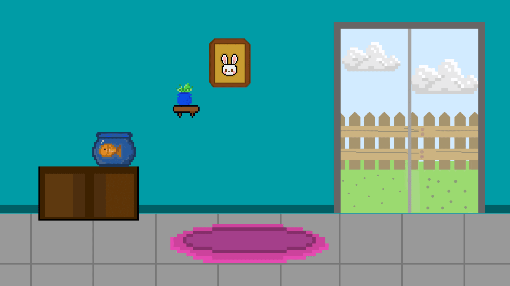 
  <p>Feito pela própria equipe (2026)</p> 
  </div> 
  <div align="center"> 
  <p>Tela de Banho</p> 
  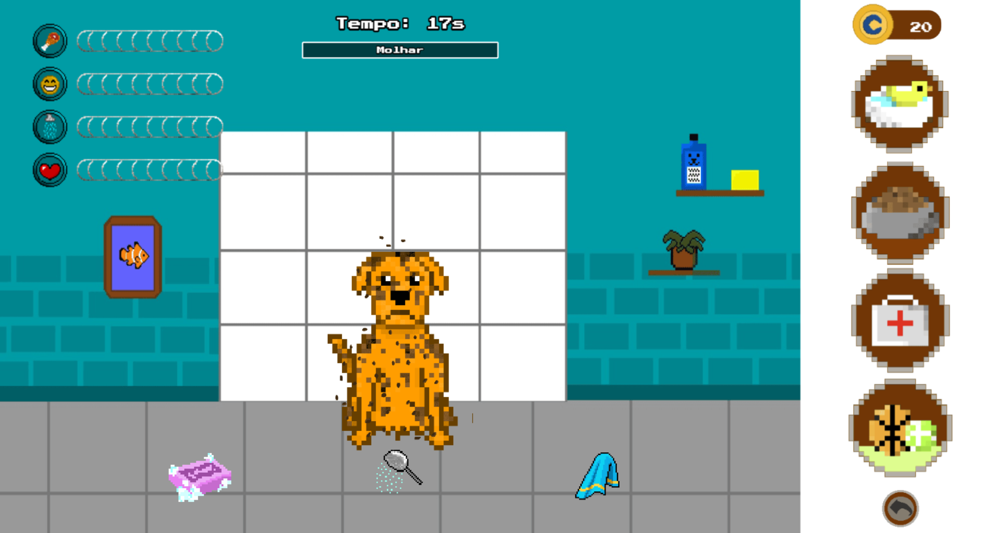
   <p>Feito pela própria equipe (2026)</p> 
   </div>


**Desenvolvimento Visual e Elementos Gráficos**

No aspecto visual, foram desenvolvidos os sprites dos personagens, incluindo os diferentes estados do cachorro (sujo e limpo), além do cenário da área de banho.
Esses elementos visuais são fundamentais para proporcionar feedback ao jogador e tornar a experiência mais imersiva.
Essas implementações contribuem para os requisitos não funcionais RNF2, RNF5 e RNF6, relacionados ao feedback visual, organização da interface e consistência gráfica.
Para as próximas etapas, foi planejada a ampliação da produção de sprites, o aprimoramento dos cenários em pixel art e o desenvolvimento do quiz educativo sobre alimentação, atendendo futuramente ao requisito RF18.

**Dificuldades Enfrentadas**

Durante esta sprint, a equipe enfrentou desafios técnicos relacionados principalmente à utilização do framework Phaser, especialmente na implementação de mecânicas interativas baseadas em eventos de clique e execução sequencial de ações.
Além disso, foram identificadas dificuldades na criação e refinamento dos cenários em pixel art, exigindo maior atenção aos aspectos visuais nas etapas seguintes.
Apesar dessas limitações, a equipe conseguiu avançar na construção das principais mecânicas do jogo, consolidando uma base funcional importante para a continuidade do desenvolvimento.


## 4.3. Desenvolvimento intermediário do jogo 

A terceira sprint teve como objetivo a implementação e o aprimoramento de elementos fundamentais da jogabilidade do Cobasi Shelter, focando principalmente no desenvolvimento dos minigames que simulam diferentes formas de cuidado com animais domésticos. Nesta etapa do projeto, a equipe concentrou seus esforços na implementação das mecânicas principais dos minigames, no refinamento das interações do jogador com os objetos do jogo e na estrutura de recompensas utilizando Cobasi Coins (RF7, RF8, RF11, RNF3).

O desenvolvimento desta sprint foi essencial para transformar o protótipo inicial em uma versão mais completa e interativa do jogo, permitindo que os jogadores experimentem na prática as principais atividades relacionadas ao cuidado com os animais (RF7, RF8). A seguir, estão descritas as principais funcionalidades implementadas nesta fase do desenvolvimento.

**Implementação do Minigame de Banho**

Um dos principais avanços desta sprint foi o desenvolvimento do minigame de banho, no qual o jogador deve limpar completamente um cachorro utilizando diferentes ferramentas disponíveis no ambiente do banheiro (RF10).
Neste minigame, o jogador utiliza o mouse para selecionar e utilizar três objetos principais: sabão, chuveiro e toalha. O processo de limpeza ocorre em três etapas (RF12, RF13, RF14):

Aplicação do sabão sobre o animal, fazendo com que ele fique coberto por espuma;

Utilização do chuveiro para remover todas as bolhas de sabão;

Secagem completa do animal utilizando a toalha.

O jogador deve passar cada ferramenta por todo o corpo do animal para que a etapa seja considerada concluída. Apenas após completar corretamente todas as fases do processo de limpeza o minigame é finalizado.
Ao concluir o desafio com sucesso, o jogador recebe Cobasi Coins, que funcionam como sistema de recompensa dentro do jogo (RF11, RNF2).

Cena do minigame de banho

<div align="center">
 <p>Minigame de Banho</p>
  
 <p>Feito pela própria equipe (2026)</p>
  </div>

**Implementação do Minigame de Alimentação**

Outro avanço importante desta sprint foi o desenvolvimento do minigame de alimentação, que tem como objetivo ensinar de forma lúdica quais alimentos são adequados ou prejudiciais para os animais (RF16, RF18).
Neste minigame, o jogador controla o cachorro utilizando as setas do teclado, movimentando o animal para a direita ou para a esquerda na tela. Durante a partida, diferentes itens caem do topo da tela (RF19, RF20, RF21, RF22):

Ração Standard, que concede 10 pontos;

Ração Super Premium, que concede 25 pontos e recupera uma vida;

Itens prejudiciais, como chocolate, que fazem o jogador perder uma vida.

O jogador inicia o minigame com três vidas e deve coletar apenas os alimentos corretos enquanto evita os itens prejudiciais (RF22). O objetivo é atingir a pontuação de 200 pontos para concluir o desafio.
Após atingir essa pontuação, o minigame é finalizado e o jogador recebe Cobasi Coins como recompensa (RF11).

Cena do minigame de alimentação

<div align="center"> 
<p>Minigame de Alimentação</p> 
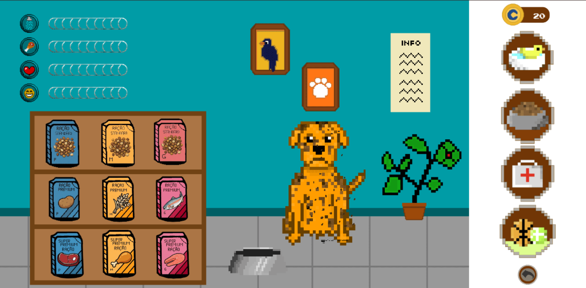
 <p>Feito pela própria equipe (2026)</p> 
 </div>

**Implementação do Minigame Veterinário**

Também foi desenvolvido o minigame veterinário, no qual o jogador deve ajudar a cuidar da saúde do animal removendo pulgas com o auxílio de uma pinça (RF23, RF24).
Neste minigame, o jogador utiliza o mouse para selecionar a pinça e movimentá-la pela tela. Ao posicionar a ferramenta sobre uma pulga, o jogador deve clicar para removê-la (RF25, RNF7).

O objetivo do minigame é retirar todas as pulgas do animal no menor tempo possível. Para avaliar o desempenho do jogador, foi implementado um sistema de classificação baseado em estrelas (RF25):

3 estrelas – tempo inferior a 30 segundos;

2 estrelas – tempo entre 31 e 45 segundos;

1 estrela – tempo superior a 45 segundos.

Após remover todas as pulgas e concluir o desafio, o jogador também recebe Cobasi Coins como recompensa (RF11).

Cena do minigame veterinário

<div align="center"> 
<p>Minigame de Veterinário</p> 
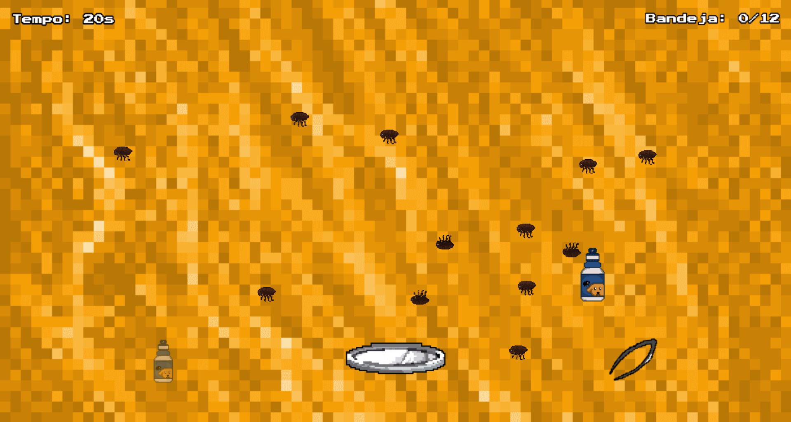
 <p>Feito pela própria equipe (2026)</p>
 </div>

**Dificuldades encontradas durante a sprint**

Durante o desenvolvimento desta sprint, a equipe enfrentou algumas dificuldades técnicas relacionadas principalmente à implementação das interações entre os objetos e os personagens dentro dos minigames. Um dos principais desafios foi ajustar corretamente as colisões e interações entre os elementos da tela, garantindo que as ações do jogador fossem registradas de forma precisa (RNF7).

Outro desafio foi a integração das diferentes mecânicas de controle entre os minigames, já que alguns utilizam o mouse enquanto outros utilizam o teclado. Além disso, a equipe também enfrentou dificuldades na organização do projeto no GitLab, principalmente no controle de versões e na sincronização do código entre os membros do grupo.

Apesar desses desafios, foi possível implementar com sucesso as principais mecânicas dos minigames e estruturar uma base sólida para as próximas etapas do desenvolvimento.

**Próximos passos**

Para as próximas sprints, a equipe pretende continuar aprimorando a experiência do jogador, adicionando novos elementos ao jogo. Entre os próximos passos planejados estão:

Implementação do quiz educativo ao final dos minigames (RF18);

Aprimoramento das animações e feedbacks visuais durante as interações (RNF2, RNF3);

Integração completa do sistema de Cobasi Coins (RF11);

Melhorias na interface e na navegação entre telas (RNF3, RNF6);

Correção de possíveis bugs e otimização do desempenho do jogo (RNF9).

Essas melhorias têm como objetivo tornar o Cobasi Shelter uma experiência mais completa, interativa e educativa, reforçando a proposta do jogo de ensinar sobre os cuidados necessários com animais domésticos de forma lúdica.

## 4.4. Desenvolvimento final do MVP 

Na quarta sprint teve como objetivo consolidar o MVP do Cobasi Shelter, com foco no aprimoramento visual, expansão das mecânicas e integração dos sistemas desenvolvidos anteriormente. Nesta etapa, buscou-se alinhar a experiência do jogador,garantindo maior coerência entre jogabilidade, interface e proposta educativa do projeto.

**Aprimoramento Visual e Interface**

Durante esta fase, foram realizadas melhorias na identidade visual do jogo, incluindo a padronização das cores, menus e cenários, com base na estética da marca Cobasi. Também houve ajustes na tela inicial e na HUD, visando maior clareza e organização das informações.
Essas melhorias atendem aos requisitos não funcionais RNF5, RNF6 e RNF10, relacionados à organização visual, consistência gráfica e legibilidade, além de reforçar o requisito funcional RF2, referente à estrutura da tela inicial.
Expansão de Conteúdo e Elementos Gráficos
Foram desenvolvidos novos sprites e elementos visuais, incluindo a adição de um segundo cachorro e novos objetos utilizados nos minigames, como itens de alimentação e elementos interativos.
Essa expansão está alinhada aos requisitos RF1, RF7 e RF8, que definem a presença dos animais e a mecânica central baseada no cuidado por meio de interações.

<div align="center">
  <p>Tela de Cuidado </p>
  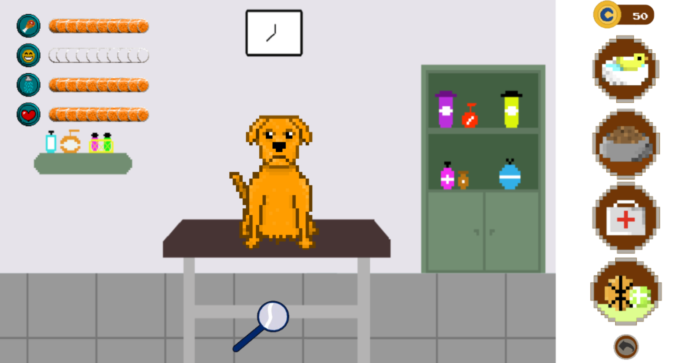
 
  <p>Feito pela própia equipe(2026)</p>
</div>

**Implementação da Área de Lazer**

Foi implementado um novo minigame na área de lazer, com mecânicas de movimentação como andar, correr e pular, tornando a experiência mais dinâmica.Nele, o animal tem que capturar os petiscos e desviar dos obstáculos.
Essa funcionalidade atende ao requisito RF26, além de contribuir para os requisitos RF7 e RNF7, relacionados à interação e responsividade dos controles.

<div align="center">
  <p>Tela do minigame de Lazer </p>
  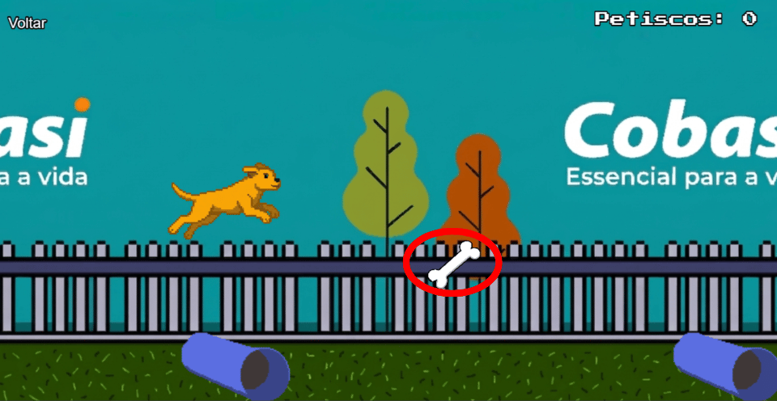
 
  <p>Feito pela própia equipe(2026)</p>
</div>

**Sistema de Progressão e Múltiplos Animais**

O jogo passou a contar com um sistema de progressão entre fases, permitindo ao jogador cuidar de mais de um animal ao longo da experiência.
Esse sistema reforça os requisitos RF5, RF7 e RF8, garantindo continuidade na jogabilidade baseada no cuidado dos animais.
Integração do Sistema de Cobasi Coins
O sistema de moedas foi integrado de forma funcional, permitindo ao jogador ganhar Cobasi Coins ao concluir minigames e utilizá-las na compra de itens, como rações.
Essa implementação atende ao requisito RF11 e se relaciona com RF16, RF17 e RF6, que envolvem os sistemas de alimentação e navegação entre áreas.
Melhorias no Minigame de Alimentação
O minigame de alimentação foi aprimorado com a adição de informações sobre os tipos de ração e um sistema de escolhas que impacta o estado do animal.
Essas melhorias atendem aos requisitos RF16, RF19, RF20, RF21 e RF22, relacionados à lógica do minigame e à aprendizagem do jogador.

<div align="center">
  <p>Tela Inicial com o novo cachorro</p>
  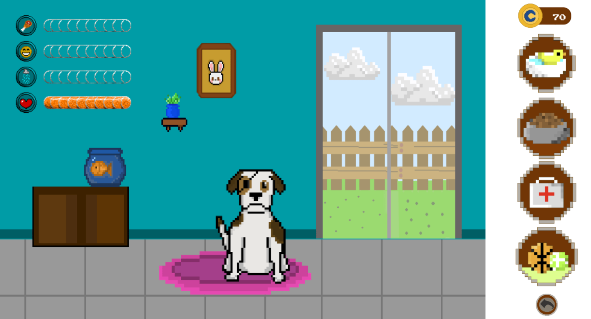
 
  <p>Feito pela própia equipe(2026)</p>
</div>

<div align="center">
  <p>Tela de ração com o novo cachorro</p>
  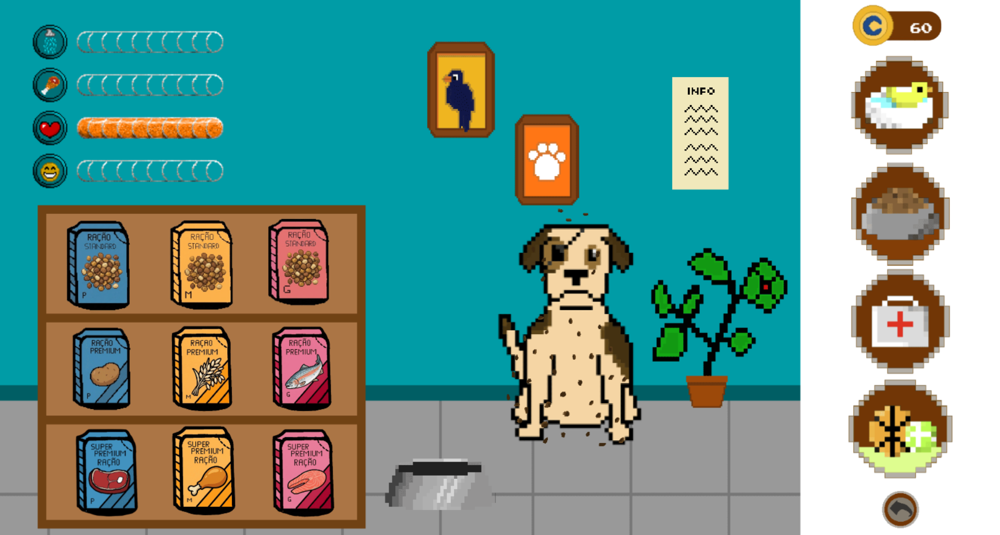
 
  <p>Feito pela própia equipe(2026)</p>
</div>


**Aprimoramento da Experiência do Usuário**

Foram adicionados elementos de UX, como trilha sonora, feedbacks visuais e telas de retorno, tornando a interação mais intuitiva e fluida.
Essas melhorias atendem aos requisitos não funcionais RNF2, RNF3, RNF4 e RNF9, relacionados à usabilidade, feedback e desempenho do sistema.


<div align="center">
  <p>Tela de Instrução de banho </p>
  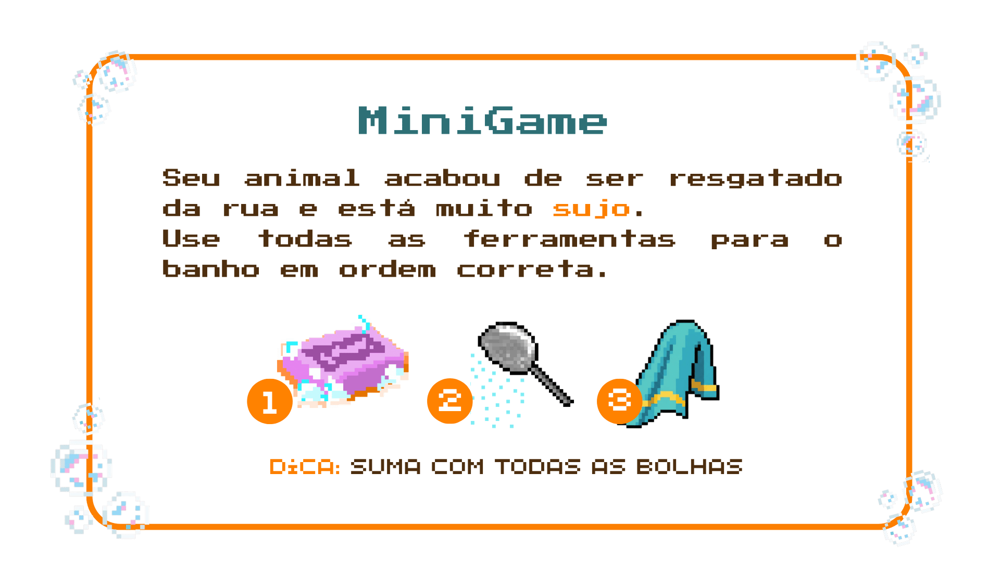
 
  <p>Feito pela própia equipe(2026)</p>
</div>

<div align="center">
  <p>Tela da compra de rações </p>
  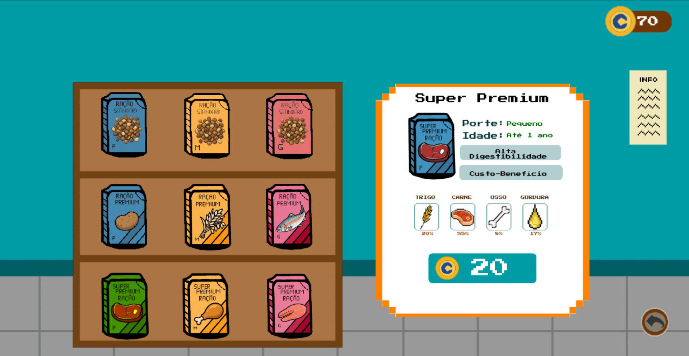
 
  <p>Feito pela própia equipe(2026)</p>
</div>


**Dificuldades Encontradas**

Durante a sprint, a equipe enfrentou desafios na integração do código no GitLab, principalmente em relação ao controle de versões e sincronização entre os membros. Também houve dificuldades de comunicação, impactando o andamento das atividades.
Apesar disso, os problemas foram contornados, contribuindo para o amadurecimento da equipe e melhoria dos processos de desenvolvimento.

**Próximos Passos**

Para a continuidade do projeto, foram definidos os seguintes próximos passos:
Implementar o quiz educativo (RF18);
Adicionar novas variações de ração (RF16);
Refinar testes e desempenho do sistema (RNF9);
Incluir novos animais (RF1);
Realizar ajustes finais de interface (RNF6 e RNF3).


## 4.5. Revisão do MVP 

Nesta etapa final do desenvolvimento, foram priorizados ajustes relacionados à correção de bugs, melhorias na usabilidade e refinamento da experiência do usuário (UX Design). O objetivo foi  proporcionar uma experiência mais fluida e intuitiva ao jogador.

**Correções e Melhorias de Jogabilidade**

Foram realizados ajustes em minigames já implementados, com foco na melhoria da jogabilidade e usabilidade.
No minigame da área de lazer, foram identificadas dificuldades relacionadas à movimentação e interação do jogador. Dessa forma, foram ajustados parâmetros como colisão e velocidade dos elementos do jogo, tornando a experiência mais responsiva e acessível.
Essas melhorias atendem ao requisito funcional RF26, além de reforçar os requisitos não funcionais RNF3 e RNF7, relacionados à usabilidade e responsividade dos controles.

**Aprimoramentos no Minigame de Banho**

O minigame de banho passou por ajustes estruturais em sua lógica de progressão. Agora, o jogador deve obrigatoriamente molhar o animal antes de prosseguir para as próximas etapas, garantindo maior coerência com o processo real de higiene.
Além disso, foi implementada uma barra de progressão que indica o avanço em cada etapa do banho, tornando a experiência mais clara e orientada.
Essas alterações atendem aos requisitos RF12, RF13 e RF14, além de contribuírem para os requisitos não funcionais RNF2 e RNF3, relacionados ao feedback visual e à clareza da interface.

**Orientação ao Jogador e Fluxo de Progressão**

Após a finalização de cada minigame, o jogador passou a receber orientações para prosseguir para as próximas atividades. Essa melhoria foi implementada com base nos resultados dos testes realizados, visando reduzir dúvidas e melhorar o fluxo de progressão.
Essa funcionalidade reforça os requisitos RF5, RF6 e RF7, além de atender ao requisito não funcional RNF3, relacionado à interface intuitiva.


**Implementação do Quiz Educativo Final**

Como parte da etapa final do desenvolvimento, foi implementado um quiz educativo ao término do jogo, que é desbloqueado após o jogador concluir o cuidado dos três animais disponíveis. Essa funcionalidade tem como objetivo revisar e reforçar os conceitos apresentados ao longo da experiência, especialmente relacionados à alimentação, higiene e cuidados gerais com os animais.

O quiz atua como um mecanismo de consolidação do aprendizado, promovendo a retenção do conhecimento de forma interativa e alinhada à proposta educativa do projeto.

Essa implementação atende diretamente ao requisito RF18, relacionado à presença de um quiz educativo na área de alimentação, além de reforçar os requisitos RF7 e RF8, que tratam do cuidado com os animais como mecânica central do jogo. Também contribui para o requisito não funcional RNF3, ao manter a interface intuitiva e de fácil compreensão.

**Reformulação do Minigame de Cuidados (Pulgas)**

O minigame da área de cuidados passou por uma reformulação significativa em sua mecânica, tornando o processo mais detalhado e realista. Agora, antes de remover as pulgas, o jogador deve utilizar um spray antipulgas, que paralisa os parasitas. Após essa etapa, o jogador deve utilizar a pinça para remover as pulgas e depositá-las em uma bandeja.

Além disso, foi implementado um limite de tempo de 50 segundos para a conclusão da atividade, incentivando agilidade e precisão por parte do jogador. Ao completar o desafio dentro do tempo estipulado, o jogador é recompensado com moedas do jogo.

Essas alterações atendem aos requisitos RF23, RF24 e RF25, relacionados à área de cuidados, à mecânica de remoção de pulgas e à avaliação baseada em desempenho. Também reforçam o requisito RF11, referente ao sistema de recompensas, e o requisito não funcional RNF7, relacionado à responsividade das interações.

**Melhorias no Minigame de Alimentação**

O minigame de alimentação também foi reformulado visualmente e funcionalmente. Os modelos das rações foram redesenhados e a estante passou a contar com uma nova organização, dividida em categorias: standard, premium e super premium.
Cada tipo de ração passou a impactar de forma diferente a barra de alimentação do animal, agregando valor estratégico à escolha do jogador.
Essas melhorias atendem aos requisitos RF16, RF17, RF19, RF20, RF21 e RF22, além de reforçar o aprendizado proposto pelo jogo.

**Implementação do Animal Final e Storytelling**

Ao final desta etapa, foi implementado o último animal do jogo, responsável por concluir a narrativa principal. Diferentemente dos anteriores, este animal não necessita de cuidados básicos como banho ou alimentação, pois já foi tratado anteriormente e devolvido ao abrigo.
Nesse contexto, o jogador deve oferecer atenção e carinho, reforçando a mensagem educativa sobre responsabilidade e cuidado com animais adotados.
Após completar essa interação, o jogador conclui sua missão e é direcionado ao quiz educativo, que tem como objetivo reforçar o aprendizado adquirido ao longo do jogo.
Essa implementação atende aos requisitos RF1, RF8, RF9 e RF18, consolidando o propósito educativo do projeto.

**Dificuldades Enfrentadas**

Durante este sprint final, a equipe enfrentou desafios relacionados principalmente à implementação de melhorias na interface do usuário, exigindo retrabalho e refinamento contínuo para atender às necessidades identificadas nos testes de usabilidade.
Além disso, houve dificuldades técnicas na implementação do sistema de quiz, uma vez que envolveu conceitos e estruturas ainda não explorados anteriormente pela equipe.
Apesar dos obstáculos, os problemas foram superados, contribuindo para o aprimoramento técnico e organizacional do grupo.

--- 

# 5. Testes

## 5.1. Casos de Teste 

&ensp;Um Caso de Teste (*Test Case*) é um roteiro detalhado de condições, variáveis, passos e resultados esperados, criado para verificar se uma funcionalidade específica de um software (ou jogo) está operando corretamente e cumprindo seus requisitos.

&ensp;Eles são essenciais para garantir a qualidade do produto, identificar bugs de forma sistemática antes do lançamento e documentar o comportamento esperado do sistema.

<div align="center">
  <p>Quadro de casos de teste</p>
</div>

<div align="center">

| Pré-condição | Descrição do teste | Condição esperada |
| :---: | :---: | :---: |
| Jogo deve apresentar a tela na proporção correta | Abrir o jogo no navegador | O jogo apresenta os elementos visuais enquadrados na tela |
| Presença funcional de feedback do usuário | Realizar interações em todas as telas | Ao passar o mouse sobre os botões, eles aumentam de tamanho |
| Botão "Settings" deve abrir a tela de configurações | Clicar no botão | A tela de configurações é exibida corretamente |
| O áudio não deve ser reproduzido quando desativado | Desativar o áudio e realizar ações | Nenhum som é reproduzido |
| Reativar o áudio deve restaurar os sons | Ativar o áudio nas configurações | Os sons voltam a ser reproduzidos |
| O cursor não deve indicar interação em áreas não interativas | Passar o mouse em áreas vazias | O cursor permanece no estado padrão |
| Botão "Jogar" deve redirecionar para o tutorial | Clicar no botão | O jogo é redirecionado para o tutorial |
| Deve ser possível avançar no tutorial | Clicar na seta direita | A próxima cena é exibida |
| Deve ser possível retornar no tutorial | Clicar na seta esquerda | A cena anterior é exibida |
| Deve ser possível pular o tutorial | Clicar em "Pular" | O jogo retorna à tela inicial |
| Deve aparecer um pop-up da ficha do cachorro ao entrar na cena inicial pela primeira vez | Finalizar o tutorial | O pop-up aparece |
| Deve ser possível fechar o pop-up da ficha do cachorro| Clicar no pop-up | O pop-up desaparece |
| Deve aparecer um pop-up de missão após fechar o de ficha | Fechar o pop-up de fichal | O pop-up de missão aparece |
| Cena de banho deve ser acessível | Clicar no botão com ícone de pato | O jogo vai para a cena de banho |
| Deve aparecer um pop-up de instrução para o minigame de banho | Entrar no jogo de banho pela primeira vez | O pop-up é exibido |
| Pop-up de instrução do minigame deve desaparecer | Clicar no pop-up | O pop-up desaparece |
| Barra de progresso deve exibir progresso continuamente | Utilizar chuveiro, sabão ou toalha | Barra mostra evolução progressiva |
| Deve ser possível arrastar o chuveiro | Clicar e arrastar | O chuveiro segue o cursor |
| Chuveiro deve molhar o cachorro| Arrastar sobre o cachorro | O cachorro fica molhado |
| Deve ser possível arrastar o sabão | Clicar e arrastar | O sabão segue o cursor |
| Objetos devem continuar interativos | Usar e tentar reutilizar | O objeto continua funcional |
| Sabão deve gerar bolhas ao ser usado | Arrastar sobre o cachorro | Bolhas aparecem indicando limpeza |
| Deve haver limite de bolhas | Gerar bolhas | Um aviso para usar o chuveiro aparece |
| Chuveiro deve remover as bolhas | Arrastar sobre o cachorro | A água remove as bolhas |
| Deve aparecer um aviso após remoção das bolhas | Usar o chuveiro | Surge aviso para usar a toalha |
| Deve ser possível usar a toalha | Clicar e arrastar | A toalha segue o cursor |
| Uso da toalha gera recompensa | Utilizar completamente | Pop-up indica ganho de moedas e tempo de conclusão |
| HUD deve ser atualizado após término do jogo | Usar a toalha | Limpeza e moedas são atualizadas |
| Ordem de uso deve ser respeitada | Tentar usar fora de ordem | Aviso é exibido |
| Cena de ração deve ser acessível | Clicar no botão com ícone de pote de ração | Cena de ração é exibida |
| Pop-up de instrução da cena de ração deve aparecer | Entrar pela primeira vez | O pop-up aparece |
| Pop-up deve fechar corretamente | Clicar no pop-up | O pop-up desaparece |
| Ficha do cachorro deve ser destacada | Fechar o pop-up de instrução | A ficha é destacada na tela |
| Ficha do cachorro deve ser acessível | Clicar na ficha | A ficha abre com as informações do cachorro |
| Ficha deve fechar ao clicar novamente | Clicar novamente | O card fecha |
| Estante deve ser destacada | Fechar a ficha | Estante das rações é destacada |
| Estante deve abrir seleção de rações | Clicar na estante | Nova cena aparece |
| Deve ser possível ver detalhes da ração | Clicar em uma ração | Informações específicas aparecem |
| Compra deve diminuir a quantidade de moedas atuais | Clicar no preço | Quantidade de moedas diminuem |
| Compra deve iniciar minigame | Clicar no preço | Minigame inicia |
| Movimento do cachorro deve funcionar | Usar teclas esquerda/direita | Cachorro se movimenta |
| Coleta de ração deve pontuar | Colidir com ração | Pontuação aumenta em 10 |
| Chocolate deve causar penalidade | Colidir com chocolate | Uma vida é reduzida |
| Jogo reinicia após perder todas vidas | Perder 3 vidas | Jogo reinicia |
| Pontuação alvo encerra o minigame | Atingir 150 pontos | Jogo encerra |
| HUD deve ser atualizado após término do jogo | Atingir 150 pontos | Fome e moedas são atualizadas |
| Cena do veterinário deve ser acessível | Clicar no botão com ícone de kit médico | Cena é exibida |
| Lupa deve iniciar interação | Usar lupa | Redirecionamento para jogo da pulga |
| Remédio anti-pulgas deve neutralizar pulgas | Clicar com o remédio na pulga  | Pulga é neutralizada |
| Pinça deve capturar pulgas | Clicar e segurar em cima da pulga | Pulga é coletada |
| Pontuação deve ser contabilizada | Depositar pulga | Pontos aumentam |
| Minigame encerra ao atingir objetivo | Coletar 12 pulgas | Jogo encerra |
| HUD deve ser atualizado após término do jogo | Coletar 12 pulgas | Saúde e moedas são atualizadas |
| Cena de lazer deve ser acessível | Clicar no botão com ícone de bola de basquete e de tênis | Cena de lazer é exibida |
| Pop-up de instrução do jogo lazer deve aparecer | Clicar no osso | Minigame inicia |
| Minigame de lazer deve iniciar | Clicar pop-up de instrução | Pop-up fecha e minigame inicia |
| Cachorro deve pular | Pressionar tecla espaço ou seta para cima | Cachorro salta |
| Colisão com obstáculo reinicia jogo | Colidir | Jogo reinicia |
| Coleta de petiscos positivos | Coletar item | Pontos aumentam |
| Coleta de petiscos negativos | Coletar item | Pontos diminuem |
| Salto especial deve funcionar | Usar cama elástica | Salto mais alto ocorre |
| Coleta do item final encerra jogo | Coletar item especial | Jogo encerra |
| HUD deve ser atualizado após término do jogo | Coletar item especial | Felicidade e moedas são atualizadas |
| Sistema de progresso deve gerar novo cachorro | Completar barras | Novo ciclo inicia |
| Nova fase deve exibir pop-up de parabéns | Completar barras | Pop-up aparece |
| Exibir pop-up do segundo cachorro | Fechar pop-up de parabéns | Pop-up aparece |
| Mecânicas devem funcionar no novo ciclo | Testar novamente | Tudo permanece funcional |

</div>

<div align="center">
  <p>Feito pela própria equipe (2026)</p>
</div>

## 5.2. Testes de jogabilidade (playtests)

 O teste de jogabilidade é uma metodologia sistemática de avaliação qualitativa e quantitativa, conduzida durante o ciclo de desenvolvimento de um software de entretenimento. Enquanto o Controle de Qualidade (QA) foca na integridade técnica do código, o playtesting concentra-se na validação da experiência do usuário (UX) e na eficácia do game design.

**Referências (Seção 7):** Unity Technologies; San Francisco: Game Developer

### 5.2.1 Registros de testes

&ensp;Os testes de jogabilidade são cruciais para este projeto, pois funcionam como a principal ferramenta de validação do game design, garantindo que as mecânicas planejadas sejam intuitivas e divertidas para o público-alvo, e não apenas para os desenvolvedores. Ao observar a interação real de usuários externos, é possível identificar falhas na curva de aprendizado e pontos de frustração que a "cegueira do desenvolvedor" costuma ocultar, permitindo ajustes precisos no equilíbrio entre desafio e recompensa.

&ensp;Além do aspecto criativo, o playtesting atua como uma estratégia de mitigação de riscos e custos, detectando problemas de usabilidade e de fluxo antes que recursos significativos sejam investidos em polimento ou marketing. Em última análise, ele assegura que o produto final entregue uma experiência de usuário (UX) consistente e envolvente, aumentando drasticamente as chances de retenção de jogadores e o sucesso comercial do jogo no mercado.

&ensp;A aplicação dos testes seguiu um padrão para cada pessoa que quis testar o jogo. Em uma sala movimentada, um computador de um integrante do grupo foi disponibilizado com o jogo funcionando, tanto com mouse quanto com fones de ouvido disponíveis. Primeiro, o contexto e os objetivos a serem atingidos foram apresentados ao tester. Depois disso, ele(a) foi instruído(a) apenas a jogar, sem nenhuma explicação, tanto prévia quanto solicitada. Por fim, o usuário foi submetido a uma série de perguntas sobre a visão geral do jogo e a um formulário de questionamentos, semelhante ao levantamento apresentado a seguir. O processo de teste do jogo foi conduzido, no dia 31/03/2026, por três integrantes do grupo: um contextualizando, outro gravando e outro preenchendo o formulário.

<div align="left">

| Nome                                     | Soraya                                               |
| ---------------------------------------- | ---------------------------------------------------- |
| Idade                                    | 18 anos                                              |
| Curso                                    | Ciência da Computação                                |
| Tem ou já teve algum pet?                | Sim, possuo                                          |
| Já possuía experiência prévia com games? | Sim, mas pouca                                       |
| Conseguiu iniciar o jogo?                | Sim                                                  |
| Entendeu as regras e mecânicas do jogo?  | Entendeu com poucas dúvidas                          |
| Conseguiu progredir no jogo?             | Sim, mas não conseguiu concluir                      |
| Apresentou dificuldades?                 | Sim, no mini game de lazer                           |
| Que nota deu ao jogo?                    | 9.0                                                  |
| Qual mini game mais gostou?              | Banho                                                |
| O que poderia melhorar no jogo?          | Dificuldade alta e salto duplo no mini game de lazer |

| Nome                                     | Anthony                                                                                       |
| ---------------------------------------- | --------------------------------------------------------------------------------------------- |
| Idade                                    | 19 anos                                                                                       |
| Curso                                    | Engenharia de Computação                                                                      |
| Tem ou já teve algum pet?                | Não, mas tem vontade                                                                          |
| Já possuía experiência prévia com games? | Sim, muita                                                                                    |
| Conseguiu iniciar o jogo?                | Sim                                                                                           |
| Entendeu as regras e mecânicas do jogo?  | Não teve dúvidas                                                                              |
| Conseguiu progredir no jogo?             | Sim. Concluiu com facilidade                                                                  |
| Apresentou dificuldades?                 | Sim, no mini game de cuidados (pegar pulgas)                                                  |
| Que nota deu ao jogo?                    | 9.0                                                                                           |
| Qual mini game mais gostou?              | Cuidados                                                                                      |
| O que poderia melhorar no jogo?          | Hitbox dos ossos e obstáculos no mini game de lazer; Hitbox da pinça no mini game de cuidados |

| Nome                                     | Pedro                                                                           |
| ---------------------------------------- | ------------------------------------------------------------------------------- |
| Idade                                    | 18 anos                                                                         |
| Curso                                    | Engenharia de Computação                                                        |
| Tem ou já teve algum pet?                | Sim, possuo                                                                     |
| Já possuía experiência prévia com games? | Sim                                                                             |
| Conseguiu iniciar o jogo?                | Sim                                                                             |
| Entendeu as regras e mecânicas do jogo?  | Não teve dúvidas                                                                |
| Conseguiu progredir no jogo?             | Sim, concluiu com facilidade                                                    |
| Apresentou dificuldades?                 | Não, nenhuma                                                                    |
| Que nota deu ao jogo?                    | 9.0                                                                             |
| Qual mini game mais gostou?              | Lazer                                                                           |
| O que poderia melhorar no jogo?          | Intuitividade na sequência de tarefas; Hitbox da pinça no mini game de cuidados |

| Nome                                     | Ludmilla                               |
| ---------------------------------------- | -------------------------------------- |
| Idade                                    | 20 anos                                |
| Curso                                    | Engenharia de Software                 |
| Tem ou já teve algum pet?                | Não, mas já possuí                     |
| Já possuía experiência prévia com games? | Sim, mas pouca                         |
| Conseguiu iniciar o jogo?                | Sim                                    |
| Entendeu as regras e mecânicas do jogo?  | Entendeu com poucas dúvidas            |
| Conseguiu progredir no jogo?             | Sim, concluiu com dificuldade          |
| Apresentou dificuldades?                 | Sim, no jogo de lazer                  |
| Que nota deu ao jogo?                    | 9.0                                    |
| Qual mini game mais gostou?              | Alimentação                            |
| O que poderia melhorar no jogo?          | Intuitividade na sequência de tarefas; |

| Nome                                     | Vitor                                               |
| ---------------------------------------- | --------------------------------------------------- |
| Idade                                    | 18 anos                                             |
| Curso                                    | Engenharia de Software                              |
| Tem ou já teve algum pet?                | Sim, possui                                         |
| Já possuía experiência prévia com games? | Sim                                                 |
| Conseguiu iniciar o jogo?                | Sim                                                 |
| Entendeu as regras e mecânicas do jogo?  | Entendeu com poucas dúvidas                         |
| Conseguiu progredir no jogo?             | Sim, concluiu com facilidade                        |
| Apresentou dificuldades?                 | Sim, no jogo de lazer                               |
| Que nota deu ao jogo?                    | 9.0                                                 |
| Qual mini game mais gostou?              | Cuidados                                            |
| O que poderia melhorar no jogo?          | Hitbox dos ossos e obstáculos no mini game de lazer |

| Nome                                     | Henrique                     |
| ---------------------------------------- | ---------------------------- |
| Idade                                    | 17 anos                      |
| Curso                                    | Ciência da Computação        |
| Tem ou já teve algum pet?                | Sim, possui                  |
| Já possuía experiência prévia com games? | Sim                          |
| Conseguiu iniciar o jogo?                | Sim                          |
| Entendeu as regras e mecânicas do jogo?  | Não teve dúvidas             |
| Conseguiu progredir no jogo?             | Sim, concluiu com facilidade |
| Apresentou dificuldades?                 | Poucas, no jogo de lazer     |
| Que nota deu ao jogo?                    | 9.0                          |
| Qual mini game mais gostou?              | Lazer                        |
| O que poderia melhorar no jogo?          | Cores das rações             |

</div>


### 5.2.2 Melhorias

&ensp;Após uma extensa seção de testes, a equipe levantou todos os relatos de bugs e sugestões para revisar rigorosamente a qualidade do jogo para o usuário. Sendo assim, as melhorias a serem aplicadas são:

* Aprimoramento final dos sprites das rações, da pinça e do cachorro correndo;
* Aprimoramento da intuitividade na sequência de atividades a serem feitas;
* Aprimoramento da interface do usuário;
* Diminuição da dificuldade do minigame de lazer;
* Substituição da pinça por um remédio;
* Ajuste na ordem das barras de status;
* Ajuste na ordem da mecânica de limpeza do cachorro;
* Ajuste dos pop-ups de feedback;
* Ajuste da intuitividade da sequência de tarefas para o usuário;
* Ajuste da distribuição das rações (Standard, Premium, Super Premium) em uma cena;
* Ajuste no sprite presente no minigame de alimentação (adicionar o mesmo que é comprado);
* Ajuste nas hitboxes do cachorro, dos ossos e dos obstáculos no minigame de lazer;
* Ajuste na posição dos ossos no minigame de lazer;
* Ajuste no balanço do rabo dos cachorros;
* Adicionar um temporizador em todos os minigames;
* Adicionar um terceiro cachorro;
* Adicionar informações reais dos cachorros das ONGs parceiras da Cobasi.

---


# 6. Conclusões e trabalhos futuros


O desenvolvimento do jogo Cobasi Shelter permitiu atingir de forma consistente os objetivos propostos na Seção 1 deste documento, especialmente no que se refere à conscientização sobre os cuidados com animais domésticos e ao alinhamento com o propósito social da marca Cobasi.
A solução desenvolvida conseguiu integrar educação e entretenimento, utilizando mecânicas interativas que simulam situações reais de cuidado com pets, como higiene, alimentação, saúde e lazer. Dessa forma, o jogo atende diretamente ao objetivo de transformar o aprendizado em uma experiência prática, permitindo que o usuário compreenda, na prática, as responsabilidades envolvidas na adoção e manutenção de um animal.
Além disso, o projeto se mostrou eficaz ao incorporar elementos da identidade da Cobasi, utilizando produtos, ambientação e narrativa alinhados à missão, visão e valores da empresa. Esse fator contribui para o fortalecimento da marca e para a criação de uma experiência imersiva, aproximando o jogador do contexto real do cuidado animal.

Outro ponto relevante foi a proposta inclusiva do jogo, com a escolha de uma protagonista jovem, representando o público-alvo da Geração Z, o que contribui para maior identificação e engajamento dos usuários. Também se destaca o caráter educativo do jogo, reforçado pelos minigames e pelo sistema de feedback, que orienta o jogador durante sua jornada.

**Pontos Fortes**

Entre os principais pontos fortes do projeto, destacam-se:

* Integração entre aprendizado e jogabilidade de forma lúdica e acessível;
* Alinhamento com o propósito social da Cobasi, especialmente no incentivo à adoção responsável;
* Estrutura baseada em minigames, que torna a experiência dinâmica e interativa;
* Sistema de progressão e recompensas, que estimula o engajamento do jogador;
* Uso de feedback visual e mecânicas intuitivas, favorecendo a usabilidade.

**Pontos a Melhorar**

Apesar dos resultados positivos, foram identificadas algumas oportunidades de melhoria ao longo do desenvolvimento e dos testes realizados:

* Necessidade de maior refinamento na interface do usuário (UI/UX);
* Ajustes na responsividade e precisão das interações;
* Presença de pequenos bugs em mecânicas específicas;
* Limitações na variedade de conteúdos (animais, produtos e cenários);
* Aprimoramento dos elementos visuais, como sprites e animações.

**Trabalhos Futuros**

Com base nos testes realizados e nas limitações identificadas, foram definidos alguns planos de ação para futuras evoluções do projeto:

* Adição de novos animais, como gatos (RF1), ampliando a diversidade do jogo;
* Expansão da lógica de produtos, incluindo novos tipos de ração e itens interativos (RF16);
* Implementação completa e aprimoramento do quiz educativo (RF18);
* Refatoração do código para melhoria de organização, manutenção e escalabilidade;
* Aprimoramento dos sprites e da qualidade visual do jogo (RNF6);
* Inclusão de mais efeitos sonoros e melhorias no sound design, visando maior imersão (RNF2);
* Otimização de desempenho e redução de falhas técnicas (RNF9).

Além disso, como evolução conceitual do projeto, o jogo pode incorporar novas funcionalidades, como:

* Sistema mais aprofundado de narrativa e tomada de decisão;
* Personalização dos animais;
* Expansão do sistema educativo com novos temas (saúde, comportamento, adoção);
* Integração com plataformas digitais ou ações reais da marca Cobasi.

**Considerações Finais**

De modo geral, o Cobasi Shelter se apresenta como uma solução viável, funcional e alinhada aos objetivos propostos, conseguindo unir tecnologia, educação e impacto social em uma única experiência digital. O projeto demonstra potencial de expansão e evolução, podendo se tornar uma ferramenta ainda mais completa de conscientização sobre o bem-estar animal.


# 7. Referências

CONSELHO ADMINISTRATIVO DE DEFESA ECONÔMICA (CADE). CADE clears merger of Petz and Cobasi. 23 jun. 2025. Disponível em: https://www.gov.br/cade/en/matters/news/cade-clears-merger-of-petz-and-cobasi. Acesso em: 27 fev. 2026.

E-COMMERCE BRASIL. Relatório sobre o crescimento do comércio eletrônico no Brasil. 2023. Disponível em: https://www.ecommercebrasil.com.br. Acesso em: 27 fev. 2026.

PORTER, Michael E. The five competitive forces that shape strategy. Harvard Business Review, 2008.

SBVC – Sociedade Brasileira de Varejo e Consumo. Estudos sobre comportamento do consumidor e varejo digital. 2024. Disponível em: https://sbvc.com.br. Acesso em: 27 fev. 2026.

INVESTING.COM. Brazilian pet product retailer Petz shares soar on Cobasi merger deal. 2024. Disponível em: https://www.investing.com/news/stock-market-news/brazilian-pet-product-retailer-petz-shares-soar-on-cobasi-merger-deal-3575949
. Acesso em: 27 fev. 2026.

PETZCOBASI RI. Central de Resultados - Cobasi. 25 fev. 2026. Disponível em: https://ri.petzcobasi.com.br/informacoes-financeiras/central-de-resultados-cobasi/
. Acesso em: 27 fev. 2026.

ASSOCIAÇÃO BRASILEIRA DE SUPERMERCADOS (ABRAS). Overview do mercado pet brasileiro 2025. São Paulo: ABRAS, 2025. Disponível em: https://static.abras.com.br/pdf/food-retail-future/overview-do-mercado-pet-abras-2025.pdf
. Acesso em: 12 fev. 2026.

CONSUMIDOR MODERNO. Fusão entre Petz e Cobasi cria gigante do varejo pet no Brasil. 2024. Disponível em: https://consumidormoderno.com.br/fusao-petz-cobasi/
. Acesso em: 12 fev. 2026.

NEOFEED. A fusão Petz-Cobasi vai esmagar as vendas do pequeno pet shop?. 2024. Disponível em: https://neofeed.com.br/negocios/a-fusao-petz-cobasi-vai-esmagar-as-vendas-do-pequeno-pet-shop-diz-ceo-da-petland/
. Acesso em: 12 fev. 2026.

REVISTA POWER SUPPLY. Petlove em evidência: crescimento e consolidação no mercado pet. 2024. Disponível em: https://www.revistapowersupply.com/blog/petlove-em-evidencia
. Acesso em: 12 fev. 2026.

CONSELHO ADMINISTRATIVO DE DEFESA ECONÔMICA (CADE). Cade aprova fusão entre Petz e Cobasi com restrições. 2024. Disponível em: https://www.gov.br/cade/en/matters/news/cade-conditionally-clears-merger-of-petz-and-cobasi
. Acesso em: 12 fev. 2026.

PET CONECTA DIGITAL. Criação da União Pet lança alerta de desequilíbrio no mercado. 2026. Disponível em: https://www.petconectadigital.com.br/panorama-petvet/criacao-da-uniao-pet-lanca-alerta-de-desequilibrio-no-mercado
. Acesso em: 27 fev. 2026.

PANORAMA PET VET. Lista das maiores indústrias de rações tem 4 brasileiras. 2024. Disponível em: https://www.petconectadigital.com.br/panorama-petvet/lista-das-maiores-industrias-de-racoes-tem-4-brasileiras
. Acesso em: 27 fev. 2026.

ISTOÉ PET. Pesquisa global aponta: vivemos uma nova era de tutores e pets. 12 nov. 2024. Disponível em: https://pet.istoe.com.br/pesquisa-global-aponta-vivemos-uma-nova-era-de-tutores-e-pets
. Acesso em: 27 fev. 2026.

SINDAN. Descubra quais são os principais perfis de tutores de pets de acordo com pesquisa Radar Pet 2020. 2020. Disponível em: https://sindan.org.br/release/descubra-quais-sao-os-principais-perfis-de-tutores-de-pets-de-acordo-com-pesquisa-radar-pet-2020/. Acesso em: 18 mar. 2026.

PET E PET. Humanização pet: o futuro do bem-estar animal em 2025. 10 nov. 2025. Disponível em: https://petepet.pet/2025/11/10/humanizacao-pets-bem-estar-mercado-pet-2025/. Acesso em: 18 mar. 2026.

DESCONTOS RADAR. Mercado pet no Brasil: vendas online e projeções até 2026. 19 fev. 2026. Disponível em: https://descontosradar.com/2026/02/19/mercado-pet-brasil-vendas-online-2026/. Acesso em: 22 mar. 2026.

MANZONI NEWS. Panorama do mercado pet brasileiro em 2026 — projeção de R$ 80 bilhões. 2026.
Disponível em: https://manzoni.com.br/manzoni-news-panorama-do-mercado-pet-brasileiro-em-2026. Acesso em: 22 mar. 2026.

WORLD ORGANISATION FOR ANIMAL HEALTH (WOAH). Animal welfare. Paris: WOAH, 2022. Disponível em: https://www.woah.org/en/what-we-do/animal-health-and-welfare/animal-welfare/. Acesso em: 24 mar. 2026.

INSTITUTO PET BRASIL. Dados do setor pet. São Paulo: Instituto Pet Brasil, 2024. Disponível em: https://institutopetbrasil.com/setor-pet/dados-do-setor-pet/. Acesso em: 24 mar. 2026.

OPINION BOX; GOLDEN. Pesquisa sobre adoção de animais no Brasil: comportamento e perfil dos adotantes. 2023. Disponível em: https://blog.opinionbox.com/pesquisa-adocao-de-animais/
. Acesso em: 27 fev. 2026.

---
# Anexos

*Inclua aqui quaisquer complementos para seu projeto, como diagramas, imagens, tabelas etc. Organize em sub-tópicos utilizando headings menores (use ## ou ### para isso)*
